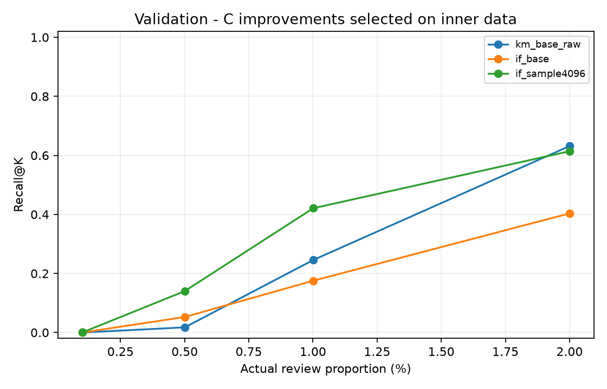
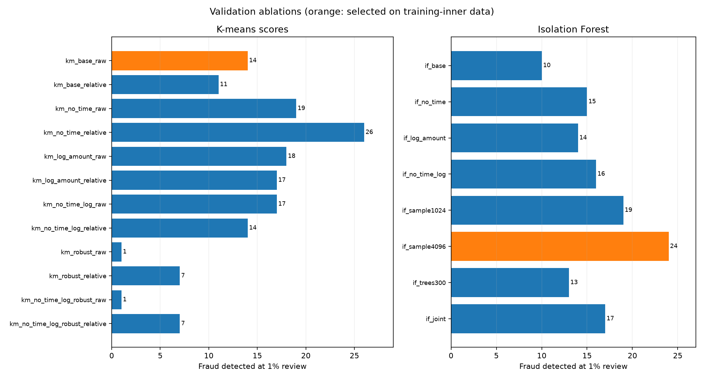

# C 第二轮改进：方法、真实结果与交接

负责人 C，2026-11-11。本轮已完成预定实验、代码、恢复核对和图表，原始基线 `results/c_validation/` 保留不动。**当前交给 A 的改进候选是 IF：100 棵树、max_samples=4096、其余原始输入与 StandardScaler 不变。** 这是训练内选定并在正式验证段确认的结果，尚不是最终测试成绩。

## 核心效果

同一正式验证段共 56,745 笔、57 笔欺诈；1% 预算实际审核 K=568：

| 方法 | TP | FP | Recall | Precision | AP |
|---|---:|---:|---:|---:|---:|
| 原簇中心距离 | 14 | 554 | 24.56% | 2.46% | 0.022831 |
| 原 IF（抽样 256） | 10 | 558 | 17.54% | 1.76% | 0.016546 |
| 内层选定改进 IF（抽样 4096） | 24 | 544 | 42.11% | 4.23% | 0.030021 |

相对原 IF，多检出 14 笔；相对原来最好的距离方法，多检出 10 笔，Recall 增加 17.54 个百分点。仍有 33 笔欺诈漏检，审核名单多数仍是正常交易，不能把改进描述为已经达到高精度。

| 预算 | K | 原距离 TP | 原 IF TP | 改进 IF TP |
|---|---:|---:|---:|---:|
| 0.1% | 57 | 0 | 0 | 0 |
| 0.5% | 284 | 1 | 3 | 8 |
| 1%（主预算） | 568 | 14 | 10 | 24 |
| 2% | 1,135 | 36 | 23 | 35 |

提升集中在本轮预定的中间预算。最小预算仍为零，2% 时原距离略好于改进 IF；不能宣称所有容量下都更好。



## 如何控制本轮开发

本轮协议在拟合前提交，见 [C_IMPROVEMENT_PROTOCOL.md](C_IMPROVEMENT_PROTOCOL.md)，提交 `199ad5e`。原始第一轮验证结果已经被查看过，这一点明确保留在机器记录中；正式验证段不应被描述为全新、从未查看的外部数据。

A 的唯一正式三段划分不变。在 A 训练段内部增加一次时间开发划分：

| 内层用途 | 笔数 | 欺诈 | Time 范围 |
|---|---:|---:|---|
| 内层拟合 | 136,186 | 258 | 0–81,825 |
| 内层选择 | 34,049 | 84 | 81,826–120,392 |

同一时间不跨边界。模型和缩放、簇内距离标定都只 fit 内层前段。种子 42/43/44 只在内层比较；以 1% 预算平均 TP 最大选择，并列比较平均 AP，再按预定候选顺序。**选定配置和配额先落盘，随后才在完整 A 训练段重拟合并给正式验证段打分。** 最终固定 seed=42。

模型拟合本身没有使用标签；内层选择明确使用标签，不能把整个流程称为完全不使用标签。测试段没有模型评分。本轮 14 种拟合配置产生 20 种评分，内层三种子共 42 次拟合、60 行评分；加上全训练重拟合共 56 次拟合。

## 完成的消融对照

K-means 固定 k=3、n_init=10，用来隔离本轮改动；它仍沿用第一轮的训练结构选择，不为每种新特征另搜一遍 k。

| K-means 配置 | 原始距离 TP@1% | 簇内相对距离 TP@1% |
|---|---:|---:|
| 原始输入 + StandardScaler | 14 | 11 |
| 去掉 Time | 19 | 26 |
| Amount 取 log1p | 18 | 17 |
| 去 Time + log 金额 | 17 | 14 |
| 原始输入 + RobustScaler | 1 | 7 |
| 去 Time + log 金额 + RobustScaler | 1 | 7 |

相对距离使用 `(d − 当前簇训练距离中位数) / 当前簇训练距离 IQR`。零 IQR 使用预定正下界；验证数据不会重新估计这些统计量。保留所有输入交易，未按极端金额或标签删行。

| IF 配置（未列参数沿用原始设置） | TP@1% |
|---|---:|
| 原始 100 棵 / 抽样 256 | 10 |
| 去 Time | 15 |
| log 金额 | 14 |
| 去 Time + log 金额 | 16 |
| 抽样 1024 | 19 |
| 抽样 4096 | 24 |
| 树数 300 | 13 |
| 预定联合：去 Time + log 金额、300 棵、抽样 1024 | 17 |

去 Time 或取对数在部分对照中改善了正式验证指标，但叠加不保证继续提高。RobustScaler 在本组配置中明显变差，记录这一负面结果，不追加参数网格追高分。IF 抽样规模的改动在本轮效果更好；这是实验发现，不是“抽样越大一定越好”的结论。



## 为什么没有选择验证 TP=26 的那个候选

`km_no_time_relative` 的正式验证 TP 为 26，是本轮表格最高值，但其内层三种子 TP 平均仅 24.33，范围 17–39；原始距离平均为 63，三个种子都是 63。因此，按照事先确定的内层规则，距离家族保留原始距离，而不是看到正式验证 26 笔后再换过去。

IF 家族内层平均 TP 从原配置的 60.33 上升到抽样 4096 的 64.67，后者范围 63–68，平均 AP 为 0.49655；其内层结果也使它成为总体异常候选。选定结果、三个种子明细和锁定时间见 `selection_locked_before_validation.json`、`inner_summary.csv`、`inner_per_seed.csv`。

内层欺诈比例和正式验证比例不同，AP 也随数据构成变化；内层较好的结果不能直接当作后续时间段的效果保证。正式验证已经展示出明显的时间外推落差，未来最终测试仍须单独确认。

## 组合、群体与时间分析

内层在 0/25/50/75/100% 的距离配额中选定 **0% 距离、100% 改进 IF**。它是允许的纯方法端点，避免为了展示“组合”而强行混合。

正式验证 K=568 时，原距离检出的 14 笔全部已被改进 IF 覆盖；IF 另有 10 笔独有欺诈。距离配额 0/25/50/75/100% 的诊断 TP 依次为 24/24/24/22/14。保留内层选定的纯 IF，没有按验证结果重选；混合没有获得额外收益。

异常对照复用公共名单函数：其中 classifier 字段代表第一个排序（距离），anomaly 字段代表第二个排序（IF）；B_comparisons 才表示真实分类对照。

群体统一由内层保留、全训练重拟合的 K-means 定义，与第一轮原始距离模型一致。所有显示方法在同一组上评价，明确区分组内容量和一个全局 top-K 在组间的分配。群体结果和一小时验证窗口见 summary.json；空簇保留为 N/A。窗口仅是 A 接口的验证诊断，不替 A 确定最终测试窗口。

当前没有 B5 真实结果，因此没有编造分类收益。B 的标准预测 CSV 到位后，可直接接入现有参数，按预定五种分类配额完成真实分类互补与配额选择。

## 复现与文件

固定环境仍用 A 的 requirements.txt，无新增运行依赖。在仓库根目录：

```bash
source .venv/bin/activate
python -m unittest discover -s tests -v
python code/run_c_improvements.py \
  --output data/c_improvements_reproduction \
  --publish results/c_improvements_reproduction
```

原始 ULB 必须匹配 A 的 SHA-256。输出路径须新建或为空；现有第一轮和第二轮证据都保留。`--publish` 指导出聚合文件，不会推送 GitHub。

- `code/c_improvements.py`：C 的特征处理、距离标定、内层选择、保存模型评分和最终冻结评价。
- `code/run_c_improvements.py`：C 的整轮运行入口、消融表/图、共享聚合和可追溯记录。
- `tests/test_c_improvements.py`：C 的八项新增检查；整个 A/C 集合 43 项通过。
- `results/c_improvements/`：当前 20 候选对照、60 行内层记录、冻结配置、完整选定模型参数、群体/窗口汇总及 6 张图。
- `data/c_improvements_20261111_final/`：本机完整评分矩阵、标准预测、模型与错误样例，Git 忽略。

结果文件 source_commit 指向实际拟合版本；source_dirty=false，包含代码/协议哈希、A 的原始文件哈希和正式/内层 row_id 指纹。首轮改进输出也保存在本地；随后仅补齐未来 B 接入的 AP/图表导出并重跑，候选、选择规则和无 B 时的结果未变。

B 到位后运行同一命令，并追加：

```bash
--classification-predictions data/classifier_validation.csv
```

它输出 B 的 AP/预算、共同分群与窗口、名单互补和选定配额图。B 的 CSV 需要同一验证段的 row_id/Class/Time/method/score；method 只能一个。程序核对元数据并按 row_id 对齐。模型/策略来源还需 B 提供给 A，不会因为传入一个 CSV 就自动宣称 B5/G2 完成。

## A8 的冻结模型入口

A 在自己电脑复现后，加载自己可信的本地 artifact；全组 G2 后才使用测试段：

```python
import sys
sys.path.insert(0, "code")
import joblib
from c_improvements import evaluate_improved_frozen

bundle = joblib.load("data/c_improvements_reproduction/improved_models.joblib")
# test 来自 A 的唯一划分；本轮没有执行下面的测试评分。
result = evaluate_improved_frozen(bundle, test, "data/c_improved_final_test", phase="test")
```

该入口不重拟合、不重选配置/配额。B 配额冻结后可传 `classifier=classifier_test_predictions`；没有冻结配额时拒绝做分类组合。恢复检查用 `phase="validation_replay"`，本轮已在完整验证段核对分数与指标一致。

v1 的 bundle 继续用 `c_reporting.evaluate_frozen_c`；v2 的 bundle 用上面的 `evaluate_improved_frozen`。A 应按选定版本记录统一最终配置，避免混用旧评分接口与新模型。

## 质量核对与写作素材

已检查：原基线精确复现；选择记录先于正式验证评分；正式验证标签变化不会改变内层选定模型；原始输入不被修改；缩放和距离统计仅 fit 训练；模型保存恢复一致；冻结评价不调用选择函数；每个组合恰好 K 个不重复 ID；群体/global 计数一致；公开文件没有完整交易列表或模型；六张图逐张查看。当前 A/C 的 43 项检查通过，临时接入 D 分支后 50 项检查通过且无冲突；D 未实际合并。最终导出的图片与已查看版本逐字节一致，所有模型选择和指标也一致。审计记录见 `results/c_improvements/verification.json`。

可供组员审核、改写的英文分析素材：

A bounded second-round ablation study was selected using a chronological holdout within the original training partition and three fixed random seeds. The selected Isolation Forest retained the original feature representation and 100 trees, while increasing the per-tree sample size from 256 to 4,096. At the predeclared 1% validation review budget, it detected 24 of 57 fraud cases, compared with 10 for the original forest and 14 for the original cluster-distance baseline. Recall increased to 42.11%, although precision remained 4.23% and 33 fraud cases were still missed.

The improvements were budget dependent. Neither forest detected fraud at 0.1%, and the original distance method retained a slight advantage at 2%. A different distance variant detected 26 validation fraud cases but was not adopted because it had not been selected by the training-inner protocol. The frozen anomaly-pair policy chose the pure improved forest, and the validation diagnostics provided no additional detection gain from mixing the two rankings. These remain development and validation findings; the original validation partition had already been inspected, and final generalization must be assessed after the group configuration is frozen.

AIGC 记录：Codex 辅助第二轮协议、代码、运行、检查和分析材料。组员需要理解并审核后用于最终报告，结合实际使用完善 Disclosures。
