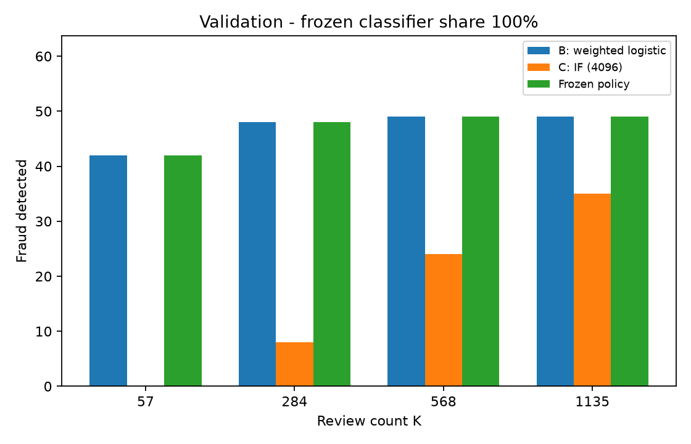
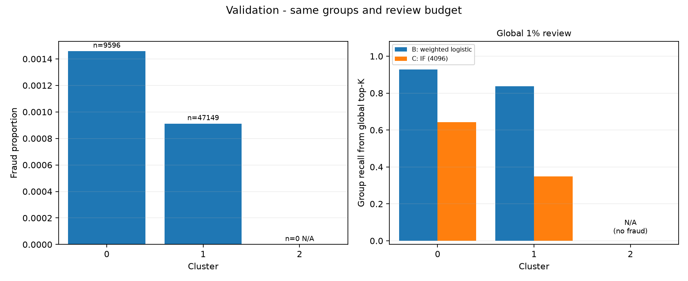
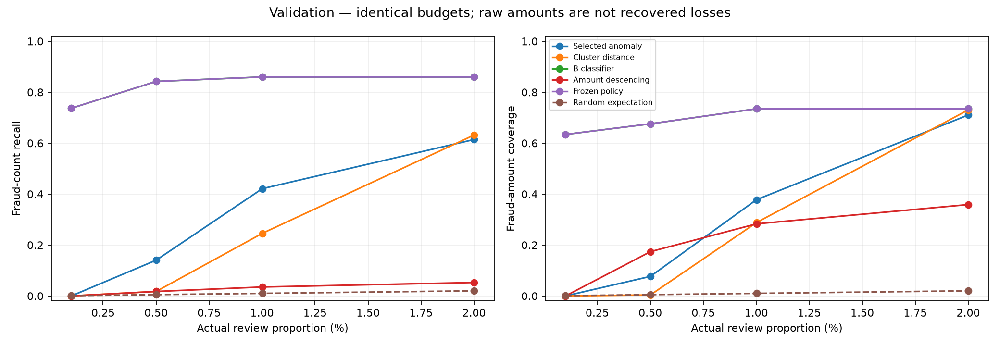
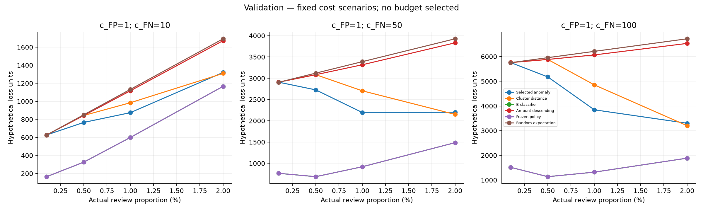
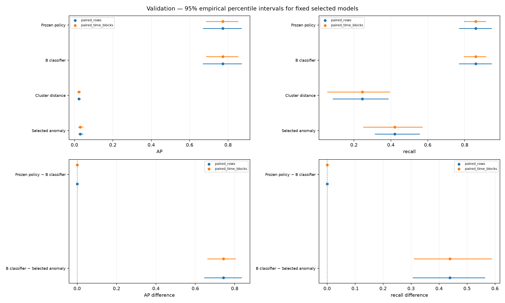

# C：方法、验证结果与运行说明

负责人 C。说明统一保存在本文件；代码在 `unsupervised.py` 和 `evaluation.py`，由 `main.py` 运行。

## 结果与当前配置

A 的原始数据校验、去重和正式时间划分保持不变：训练 170,235 笔/342 笔欺诈，验证 56,745 笔/57 笔欺诈。原始文件 SHA-256 与分段指纹见 `data/README.md` 和结果 JSON。

同样审核 K=568（1% 预算）：

| 方法 | 检出 TP | 误报 FP | Recall | Precision | AP |
|---|---:|---:|---:|---:|---:|
| 原簇中心距离 | 14 | 554 | 24.56% | 2.46% | 0.022831 |
| 原 IF：100 棵、抽样 256 | 10 | 558 | 17.54% | 1.76% | 0.016546 |
| 改进 IF：100 棵、抽样 4096 | 24 | 544 | 42.11% | 4.23% | 0.030021 |

当前交给 A 的无监督对照是改进 IF：原始 30 个输入、训练段 StandardScaler、100 棵树、max_samples=4096、contamination=auto、seed=42、n_jobs=1。其余候选和失败结果保留，不再追加调参。

| 审核预算 | K | 原距离 TP | 原 IF TP | 改进 IF TP |
|---|---:|---:|---:|---:|
| 0.1% | 57 | 0 | 0 | 0 |
| 0.5% | 284 | 1 | 3 | 8 |
| 1%（主预算） | 568 | 14 | 10 | 24 |
| 2% | 1,135 | 36 | 23 | 35 |

相对原先最好的距离，1% 下多找到 10 笔，但仍漏掉 33 笔、误报 544 笔。0.1% 未改善，2% 时原距离略好。以上均为验证结果，最终测试没有执行。


## 方法与选择规则

第一轮 K-means 在训练特征上比较 k=3/5/8、种子 42/43，固定同一 1,000 笔子样本计算 silhouette/ARI。k=3 的平均 silhouette=0.1537、ARI=0.5558，因此选 k=3、n_init=10；稳定性仍有局限，群体不能等同于欺诈类别。

第二轮协议在运行前提交（Git `199ad5e`）。正式验证此前已被查看过，本轮不能称作全新的独立验证。为减少围绕 57 笔验证欺诈选参，在 A 的训练段内按时间再做一次 80/20 开发划分，同时间进入后段：

| 用途 | 笔数 | 欺诈 | Time 范围 |
|---|---:|---:|---|
| 内层拟合 | 136,186 | 258 | 0–81,825 |
| 内层选择 | 34,049 | 84 | 81,826–120,392 |

三种子 42/43/44 比较 20 个评分候选。按内层 1% 平均 TP 最大选择，并列比较平均 AP，再按预定候选顺序；距离家族保留原距离，IF 家族选择抽样 4096，整体选 IF。选择先落盘，再用完整 A 训练段、seed=42 重拟合并报告全部正式验证对照。模型拟合不读取标签，内层选择明确使用标签。

K-means 固定 k=3，六种配置各输出原始距离与簇内相对距离，共 12 个候选。相对距离为 `(d−所属簇训练距离中位数)/训练 IQR`，零 IQR 使用预定正下界；不在验证时重新标定。IF 八种配置见下表，无额外笛卡尔积搜索。共 42 次内层拟合、14 次全训练拟合，60 行内层评分。

| K-means 配置 | 原始距离 TP@1% | 相对距离 TP@1% |
|---|---:|---:|
| 原始标准化 | 14 | 11 |
| 去 Time | 19 | 26 |
| log1p 金额 | 18 | 17 |
| 去 Time + log 金额 | 17 | 14 |
| 原始 RobustScaler | 1 | 7 |
| 去 Time + log 金额 + RobustScaler | 1 | 7 |

| IF 配置 | TP@1% |
|---|---:|
| 原始 | 10 |
| 去 Time | 15 |
| log 金额 | 14 |
| 去 Time + log 金额 | 16 |
| 抽样 1024 | 19 |
| 抽样 4096 | 24 |
| 树数 300 | 13 |
| 去 Time + log 金额、300 棵、抽样 1024 | 17 |

验证 TP=26 的距离候选未被采用：其内层平均 TP 仅 24.33、范围 17–39，原距离则平均 63、三个种子均为 63。IF 抽样 4096 内层平均 64.67、范围 63–68；原 IF 平均 60.33。按预定规则保留选择，没有看到验证表格后换配置。更大的抽样在本次有效，不保证普遍有效；RobustScaler 和叠加改动也不保证改善。


## 组合、群体与时间

距离配额候选为 0/25/50/75/100%。按内层平均 TP 选，并列优先纯方法，再优先更大的距离配额；最终选 0% 距离、100% 改进 IF。验证 K=568 时，距离检出的 14 笔均被 IF 覆盖，IF 另有 10 笔独有欺诈；五种配额的验证 TP 为 24/24/24/22/14，混合没有额外收益。

群体统一由保留的 K-means 定义：验证簇 0 有 9,596 笔/14 欺诈，簇 1 有 47,149 笔/43 欺诈，簇 2 为空。空簇保留 N/A；组内预算与一个全局 top-K 的组间分配分别记录，不能混为同预算。匿名 V 特征不赋予未知业务含义，异常分也不是欺诈概率。

复用 A 的一小时窗口作验证诊断；首尾为不完整窗口，每窗正类仅 1–12 笔。短期波动、内层和验证结果落差不能直接证明长期漂移。最终窗口由 A 在 G2 冻结。

## 文件与运行

- `code/unsupervised.py`：C 的基线、改进模型及实验流程。
- `code/evaluation.py`：C 的共同评价、图、汇总导出和冻结评价；A/B/D 复用。
- `code/main.py`：保留 A 原入口，增加 `--run-c`、`--run-c-baseline`。
- `tests/test_c_modules.py`：合并 C 的全部检查。
- `results/tables/c_baseline.json`：基线指标、配置、训练结构与画像。
- `results/tables/c_improved.json`：改进指标、锁定选择、候选、分群、窗口及审计记录。
- `results/tables/c_ablation.csv`：便于报告/海报使用的 20 候选对照。
- `results/figures/c_*.png`：主实验图、训练结构图及 c_extensions_ 前缀的三张新增验证图。

激活环境、准备数据与检查：

```bash
source .venv/bin/activate
python code/download_data.py
python -m unittest discover -s tests -v
```

复现使用新的本地目录，防止覆盖仓库已有证据；新结果仍分为 figures/ 和 tables/：

```bash
python code/main.py --run-c --output data/c_reproduction/run --results data/c_reproduction/shared
```

`--run-c-baseline` 重现第一轮，`--demo` 只运行合成检查。B 已接入。可追加 `--classification-freeze results/tables/b_freeze.json` 复核共同环境并完成分类组合；已有可靠预测也可传 `--classification-predictions data/classifier_validation.csv`（row_id/Class/Time/method/score）。本次完整复现命令如下：

```bash
python code/main.py --run-c --classification-freeze results/tables/b_freeze.json --output data/c_reproduction/run --results data/c_reproduction/shared
```

模型、完整评分矩阵、错误样例和详细中间导出保留在私有运行目录。历史共享文件与旧结构快照保存在被 Git 忽略的 `data/_layout_archive/`，也可从 Git 历史恢复。汇总里的 source_commit/代码哈希继续指向真实拟合版本；本次整理不重训、不改变模型选择或验证数值。

全组 G2 后，A 从自己复现的模型调用冻结评价：

```python
import sys
sys.path.insert(0, "code")
import joblib
from evaluation import evaluate_improved_frozen
bundle = joblib.load("data/c_reproduction/run/improved_models.joblib")
# test 由 A 的唯一划分提供；冻结后才执行。
result = evaluate_improved_frozen(bundle, test, "data/c_final_test", phase="test")
```

本次模型包位于 `data/c_with_b_20261111/improved_models.joblib`，包含核验后的 B 管线；按上面的带 B 命令重现时，同一接口会自动生成 B 分数、应用已冻结配额。它不重新拟合或选择配置；也可显式传 classifier，未冻结时拒绝分类组合。第一轮 bundle 的对应接口为 `evaluation.evaluate_frozen_c`。恢复检查使用 phase="validation_replay"。旧自定义变换器已迁移到 unsupervised 模块路径，原模型备份保留，预测需保持一致。

整理时的 44 项 A/C 检查与 51 项含 D 检查通过；本次又补入 B 接入/自动评分检查，当前检查数量见下节。原指标、选择和保留图片均已核对，两份旧模型在新模块路径下恢复后分数一致。

AIGC 记录：Codex 辅助协议、代码、训练验证、检查、结构整理与分析；组员须理解并审核，再据实际使用完善最终 Disclosures。本次已完成 B 的真实共同环境复核及 C 的配额选择，A8 最终测试尚未执行。

## B 接入规则（执行前固定）

已接入 B 的提交 55ee151，B 已公布验证结果。这里只按 B 原协议复核六个候选，使用 A 的固定依赖、数据及划分，不扩大搜索，也不修改 B 的算法或原结果。C 原先的模型/异常选择和三个内层种子规则保持不变。分类配额仍是 0/25/50/75/100%，按正式验证 1% 的 TP 最大选择，并列保留更多分类容量。正式测试留给全组 G2 后的 A8。

入口增加 `--classification-freeze results/tables/b_freeze.json`：核对数据身份、参数与版本，在本地保存 B 复核模型和预测，完成分类 AP/预算、分群、窗口与等 K 互补，再将选定配额及 B 管线一并保存。A8 冻结评价会自动使用该 B 管线，不重新训练或挑配额。C 的共享结果继续只放原来的 tables/ 和 figures/，B 已发布的文件保持原样。

## B 接入后的真实互补与冻结结果

B 分支 55ee151 已包含 A/C，因此直接接入无冲突。其原实验使用 sklearn 1.8.0 等版本，与共同依赖不同。本次在 Python 3.12.14、NumPy 2.5.4、pandas 3.1.1、sklearn 1.9.1、SciPy 1.18.1 下，按 B 原协议复核全部六个候选。未修改 B 的代码或已发布结果。

全部候选在主预算的 TP 与 B 原记录一致，选择仍为 `logistic_regression_class_weight`。该模型 AP=0.772681；随机森林 AP 从原记录 0.757048 变为 0.755615，版本差异已保留，不宣称所有数字逐位一致。重新保存/加载后，本地分数与完整排名一致。数据 SHA-256、正式划分指纹、所选参数均匹配 B 声明，真实 G1 原始逻辑回归的 AP/预算与独立复核一致。

| 预算 | K | B 分类 TP | IF TP | 冻结策略 TP |
|---|---:|---:|---:|---:|
| 0.1% | 57 | 42 | 0 | 42 |
| 0.5% | 284 | 48 | 8 | 48 |
| 1% | 568 | 49 | 24 | 49 |
| 2% | 1,135 | 49 | 35 | 49 |

主预算下，B 的 Recall=85.96%、Precision=8.63%，仍有 8 笔漏检。IF 的 24 笔欺诈全部被 B 的名单覆盖；B 独有 25 笔、IF 独有 0 笔。分类配额 0/25/50/75/100% 的 TP 分别为 24/45/48/49/49，按“TP 并列保留更多分类容量”的原规则选择 **100% 分类、0% IF**。这是合法的纯方法端点，不把它包装成混合策略改善。

2% 时 IF 有 1 笔独有欺诈，但 25% 分类配额的示例同时损失 1 笔 B 独有欺诈，检出仍是 49。其他已试配额也没有净收益。这只说明当前数据、容量和有限策略中没有组合提升，不能据此认定异常方法在所有场景都无用。



群体统一使用同一 K-means，主预算的一个全局名单中：

| 簇 | 笔数/欺诈数 | B 审核数/检出 | B Recall | IF 审核数/检出 | IF Recall |
|---|---|---|---:|---|---:|
| 0 | 9,596 / 14 | 62 / 13 | 92.86% | 258 / 9 | 64.29% |
| 1 | 47,149 / 43 | 506 / 36 | 83.72% | 310 / 15 | 34.88% |
| 2 | 0 / 0 | 0 / 0 | N/A | 0 / 0 | N/A |



三个真实案例可帮助讲解，完整行身份只保存在本地 `private_cross_method_cases.csv`：

| 案例 | 标签 | B 排名 | IF 排名 | 可支持的说明 |
|---|---:|---:|---:|---|
| C1 | 欺诈 | 4 | 605 | 分类能抓住未进入 IF 主预算名单的欺诈 |
| C2 | 欺诈 | 11,505 | 867 | IF 在 2% 容量下有独有发现，但固定容量组合未增加总检出 |
| C3 | 正常 | 56,545 | 1 | 异常程度最高也可能是正常交易，不能把异常分当欺诈概率 |

排名从 1 开始。这些是事实性案例，不从匿名特征推断具体消费或犯罪行为。

冻结记录在 `results/tables/c_improved.json` 的 config/B_reproduction/completion_verification：C 模型与原 20 候选结果未变，分类配额=1.0，threshold=null，K 向上取整、score 降序/row_id 升序；保存训练段模型，不合并 train+validation 重训。本地完整模型包自动包含 B，验证重放会核对所有风险分数、指标和容量。B 的原预测字节哈希与重建文件可能不同，原值和新值分别保存，不以字节相同冒充跨版本分数一致。

C5、C6、C8 的方法/验证写作与问答已交付。C7 的最终测试图和报告最终测试数字仍需 A 汇总 G2 并执行 A8：当前 B/D 冻结文件与本地 C 包均未宣称全组 G2 完成，所以本次没有评分测试集。不能用验证图代替最终图。

供组员审核改写的英文素材：

Under the same 1% review budget, the reproduced class-weighted logistic regression detected 49 of 57 validation fraud cases, whereas the improved Isolation Forest detected 24. All 24 anomaly detections were covered by the classifier's top-K list. The predeclared quota search therefore selected the pure-classifier endpoint: a 75% classifier quota tied its detected-fraud count, and the tie rule preferred more classifier capacity. At 2%, one anomaly-exclusive fraud case existed, but a capacity-preserving policy traded away one classifier-exclusive fraud and produced no net gain. These findings support the value of evaluating complementarity under an identical capacity constraint, rather than using the larger union of two review lists.

答辩要点：异常更稀有不代表更像已知欺诈；有独有案例不等于净收益；相同 K、去重补齐和事先固定的并列规则是比较基础；选择纯分类不是失败，而是保留有证据支持的策略。当前结论为验证结论，最终泛化仍由 A8 检查。

最终核对：46 项 A/C 检查、8 项 B 检查通过；临时加入 D 的 7 项检查后共 61 项通过且无冲突，D 未实际合入。真实 G1、完整验证的冻结重放、行身份/容量/分群计数均已核对。B 的原算法、测试及发布结果文件未改动；测试集没有评分。

## C7 接入交付（2026-11-13）

当前可以独立完成的 C7 接入、发布接口及验证重放已完成。C7 的正式测试图和 C8 的正式测试解释仍依赖 A7/G2 与 A8；本节不确认全组冻结，也没有运行测试集。仅修改 C 的评价、检查及本说明，沿用原目录。

### A 接入时使用的接口

| 接口 | 输入与责任 | 输出 |
|---|---|---|
| `evaluate_improved_frozen(bundle, data, output, *, classifier=None, phase="test", window_seconds=3600, window_origin=0)` | A 提供固定划分和 G2 的窗口设置；bundle 内含训练好的 B/C。`output` 必须为新的本地目录 | 返回总体、分群、窗口、等 K 互补结果；本地保存 evaluation.json、完整预测和图 |
| `publish_frozen_c_results(run, destination, *, provenance)` | 输入上一接口的运行目录；只发布已有结果，不训练、不评分、不选参 | 在原 tables/ 和 figures/ 中发布汇总 JSON、数值写作材料和图 |

A 从自己复现的 bundle 接入，不能依赖 C 电脑上的模型路径。未显式传 `classifier` 时使用 bundle 已包含的 B 管线；显式传入时要求 method、row_id、Time、Class 与固定方案和数据一致。数据的特征及行身份不由 C 重新划分。

窗口长度和起点现在均可显式传递；默认 3600 秒、起点 0 只复现已有验证诊断，A 须在 G2 中确认最终设置。返回的 `time_window_config` 记录实际使用值。每个窗口独立按 `ceil(N_window*q)` 分配容量，不能将窗口审核量之和直接解释为一次全局 top-K。群体图则使用全局名单在各簇的分配，两种口径须分开。

### 不接触测试集的验证重放

以下在仓库根目录运行；选择新路径，避免覆盖已有证据。此命令不会重新拟合模型。其他成员先按前文完整复现命令生成自己的 bundle，再替换模型路径。

```python
import sys
from pathlib import Path
import subprocess
import joblib
sys.path.insert(0, "code")
from preprocessing import load_data, split_data, ULB_SHA256
from evaluation import evaluate_improved_frozen, publish_frozen_c_results

bundle = joblib.load("data/c_with_b_20261111/improved_models.joblib")
_, validation, _ = split_data(load_data(Path("data/creditcard.csv")))
run = "data/c_handoff_reproduction/run"
result = evaluate_improved_frozen(
    bundle, validation, run, phase="validation_replay",
    window_seconds=3600, window_origin=0,
)
files = publish_frozen_c_results(
    run, "data/c_handoff_reproduction/shared",
    provenance={
        "source_commit": subprocess.check_output(
            ["git", "rev-parse", "HEAD"], text=True).strip(),
        "dataset_sha256": ULB_SHA256,
        "command": "C7 validation replay Python API sequence in report/C_IMPROVEMENTS.md",
    },
)
```

本次真实运行使用 `data/c_handoff_20261113/run` 和 `data/c_handoff_20261113/shared`；详细检查记录追加在已有 `results/tables/c_improved.json` 的 `C7_handoff_verification`。原模型文件、冻结选择和先前验证数字保持不变。重放过程中阻断训练与选择函数，核对保存模型和配置未改变，并检查所有选定方法的 AP/预算、群体、时间窗口与原记录一致，组合名单仍恰好 K 笔。

### G2 后 A8 的最小调用变化

A 先完成全组冻结，再将上例的 `data` 替换为同一划分中的 test、`phase` 替换为 `"test"`，并传入 G2 中记录的窗口起点和长度。运行目录使用新的本地路径。发布时额外提供 `provenance["g2_reference"]`（全组冻结文件/记录及版本），`command` 填写真实运行命令，`source_commit` 填写实际实验代码版本。发布器检查来源字段存在，但不替 A 审批 G2，也不根据测试结果修改方案。

发布后的命名：

| 内容 | 验证重放 | 正式测试 |
|---|---|---|
| 公开汇总 | `results/tables/c_validation_replay.json` | `results/tables/c_test.json` |
| 数值写作材料 | `results/tables/c_validation_replay.md` | `results/tables/c_test.md` |
| 图表前缀 | `results/figures/c_validation_replay_` | `results/figures/c_test_` |

每次发布含 PR、审核预算 Recall/Precision、簇内表现、异常方法互补图；包含 B 时另附有实际方法名称的 B/C 互补图。JSON 不发布逐行名单和完整 PR 点，保存评估文件及每张图片的 SHA-256、划分指纹、实际窗口设置和来源记录。模型、完整预测、逐行案例始终保留本地。目标同名文件已存在、缺图、缺来源或公开/私有目录相互包含时拒绝发布，保护原实验结果。无需把本次重复验证图加入 Git。

JSON 的 config 是原训练/验证阶段的候选冻结记录，其中 `test_evaluated=false`、`group_G2_complete=false` 不会被 C 接口改写；实际评分阶段看顶层 phase，全组冻结依据看 A 的 G2 记录。正式结果不能因为复制了旧配置标记而被误当成验证结果。

### C8 可提前完成的写作准备

方法与验证分析沿用前文。发布器生成的 Markdown 从实际结果填写每个方法的 AP、全部预算 TP/FP/Recall/Precision、B/C 独有与重合欺诈、组合相对分类的净变化，以及全局 1% 下的群体计数；未定义值写 N/A。它是供 C 核对、D 整合的数值材料，不代替最终解释。

拿到 A8 后，C 只需围绕以下问题补充正式结论，不追加选择：

1. 固定 IF 相对距离方法的优劣是否与验证阶段一致？同时检查 AP 和各预算，不只挑最好的一个数字。
2. 已冻结的分类配额在测试上得到多少净检出变化？纯分类端点应明确写出。测试上出现异常独有案例，也不能据此重新调整配额。
3. 各簇交易数和欺诈数是否足以支持比较？空簇、无欺诈簇用 N/A；较小群体的极端比例只作描述。
4. 时间分析由 A 提供，用同一窗口口径解释；不能仅凭两个交易日的窗口差异断言长期漂移。
5. 将最终数字与验证数字明确分开，对模型已用标签做内层选择、匿名特征解释限制及少量欺诈带来的不确定性如实说明。

交给 D 时：使用 c_test.md 的真实数字、c_test.json 的来源和 c_test_ 前缀的图；正文分别安排方法、等预算结果及局限。C 核对自己的全部数字与图注，A 核对共同划分/时间口径，D 统一文稿。最终演练和全组数字核对需等实际材料齐全后完成。

本次 AIGC 补充：Codex 协助冻结接口、发布接口、验证重放、检查与交接说明；未新增算法、未扩大参数搜索、未评分测试集。最终结果解释由组员据真实 A8 输出审核。

D 的新复核记录指出中文 Windows 的默认 GBK 会使 C 读取带中文注释的 requirements.txt 失败。本次在 C 的读取点显式指定 UTF-8，并在检查中模拟 GBK 默认编码；不再依赖用户为这个读取点设置 PYTHONUTF8。该修复不改变依赖版本或实验选择。共享 TASKS.md 保留 D 自己提交的最新进度。

本次最终检查：本分支 47 项 A/C 检查与 8 项 B 检查通过；隔离接入 D 的 f26e360 后，54 项公共检查与 8 项 B 检查通过，共 62 项。真实验证重放的三种冻结方法全部指标、群体与窗口结果一致；正式测试仍未执行。未新增跟踪文件，重复图表只保存在本地预览目录。

2026-11-13 合并记录：当时 C 与 D f26e360 仅 TASKS.md 顶部 C 进度一行有文本冲突。2026-11-14 main 已发布新的扩展路线；A6 合并时应以最新 TASKS 范围为准，保留各人真实进度，不将 D 的旧清单覆盖新分工。代码文件的兼容性由本次隔离检查核对；本次未替 A 合并 D 的业务代码。

## C-E1 / C-E2 / C-E3 完成交付（2026-11-14）

三项新增任务均已完成实现、必要检查、完整真实验证及独立复跑：C-E1 对应 E01/E06，C-E2 对应 E07，C-E3 对应 E02。C7 所需新增接口与验证图已就绪；全组 G2、A8 正式测试、C7 正式图和 C8 正式结论仍未完成。本次没有运行测试集，也没有新增模型或重新调参。

### 结果文件与复现

新增逻辑全部保存在 `code/evaluation.py`，检查仍在 `tests/test_c_modules.py`；未新增脚本、Notebook 或目录层级。共享输出只有：

- `results/tables/c_extensions.json`：冻结配置、金额/参考/成本、完整区间、来源及复验记录。
- `results/figures/c_extensions_amount.png`：同预算下的笔数/金额覆盖。
- `results/figures/c_extensions_cost.png`：固定假设成本场景。
- `results/figures/c_extensions_uncertainty.png`：逐行及时间块配对区间、方法差值。

本地运行位于 `data/c_extensions_20261114/`，包含逐行预测、可交给 A7 的 `extension_config.json` 及私有汇总。初轮检查导出保留在 `data/_layout_archive/c_extensions_20261114_initial/`。原主实验结果、B 的发布文件和已有模型不覆盖。

在 C 分支，先按前文重现带 B 的 bundle，再执行（每次用新输出/结果目录）：

```bash
python code/evaluation.py --bundle data/c_with_b_20261111/improved_models.joblib --output data/c_extensions_reproduction/run --results data/c_extensions_reproduction/shared
```

其他电脑把 bundle 路径换成自己按前文复现的模型。CLI 仅支持验证阶段；验证数据仍由 A 原 load_data/split_data 提供，并校验原始 SHA-256。各方法、配置、模型哈希、输入划分、包版本和命令在公共 JSON 中记录。`implementation_commit` 指向实际运行代码的已提交版本；原始运行时的 source_commit/source_dirty 及精确代码哈希也保留，不冒充当时工作区干净。

### E01/E06：数量与金额的差异

训练段的 Amount 分位边界为 21.94、200.0、1008.6402000000035；等于边界进入右组，外侧开放，未在验证段重新分箱。验证段欺诈交易金额总和为 12,231.09。

| 方法 | TP@1% | 笔数 Recall | 欺诈金额覆盖 | Precision 提升倍数 |
|---|---:|---:|---:|---:|
| 簇中心距离 | 14 | 24.56% | 28.80% | 24.54 |
| 改进 IF | 24 | 42.11% | 37.78% | 42.06 |
| 带权逻辑回归 | 49 | 85.96% | 73.48% | 85.88 |
| Amount 降序参考 | 2 | 3.51% | 28.30% | 3.51 |
| 已冻结 B/IF 政策 | 49 | 85.96% | 73.48% | 85.88 |
| 随机审核期望 | 0.5706（期望） | 1.001%（期望） | 1.001%（期望） | 1 |

所有方法 K=568。随机值为期望，不是一次实际抽样；K 向上取整使实际比例略高于 1%。金额参考的方向在协议中固定，不是根据结果选出的方向。

分类检出 49 笔，覆盖欺诈交易金额 8,987.38；IF 为 4,621.18。金额排序仅检出两笔却覆盖 3,460.87，说明数量和金额指标确实不同。金额覆盖不等于实际追回损失，也不能用它替换笔数评价。

全局分类名单在最高金额组审核 43 笔、检出该组两笔欺诈中的一笔；该组金额覆盖为 38.57%。这一组只有两笔欺诈，不能据此推断普遍群体差异。其余金额组及每种方法的全局名单分配在 JSON 中，组数、欺诈数、审核数、检出及金额均已加总核对。



### E07：成本假设影响预算解释

采用事前固定的 `L=FP+c_FN*FN`，c_FN=10/50/100，无真实货币单位、不要求 score 已校准。分类结果如下：

| 审核预算 | c_FN=10 | c_FN=50 | c_FN=100 |
|---|---:|---:|---:|
| 0.1% | 165 | 765 | 1515 |
| 0.5% | 326 | 686 | 1136 |
| 1% | 599 | 919 | 1319 |
| 2% | 1166 | 1486 | 1886 |

在这些验证数字和假设下，较高审核量并非总是更优，因为需要权衡新增检出与误报。这里只比较全部预定成本场景，没有选择新预算，主预算仍为 1%，没有根据表格替换原模型或配额。全部方法及随机期望的成本保留在 JSON。



### E02：配对区间与有限证据

seed=42，500 轮逐行配对、200 轮 1800 秒时间块配对，报告经验 2.5%/97.5% 分位。15 个块槽均有观测，首尾可能不完整；每轮按实际抽样 N 重新计算 K。逐行样本始终 N=56,745，正类数范围 37–79；块样本 N=44,888–63,330、正类数 29–83。本次所有轮次均有正类，其他数据出现空样本/无正类时接口会显式记录有效轮数和原因，不反复重抽掩盖问题。

| 量 | 点估计 | 逐行区间 | 时间块敏感性区间 |
|---|---:|---|---|
| 分类 AP | 0.7727 | [0.6690, 0.8712] | [0.6853, 0.8528] |
| IF AP | 0.0300 | [0.0213, 0.0449] | [0.0193, 0.0460] |
| 分类 Recall@1% | 0.8596 | [0.7692, 0.9465] | [0.7954, 0.9153] |
| IF Recall@1% | 0.4211 | [0.3129, 0.5569] | [0.2496, 0.5714] |
| 分类 − IF 的 AP | 0.7427 | [0.6441, 0.8357] | [0.6609, 0.8048] |
| 分类 − IF 的 Recall | 0.4386 | [0.3056, 0.5641] | [0.3098, 0.5882] |

在这两个重采样设定中，已选分类器保持较大优势。但这些区间条件于已选模型和当前验证样本，不包含全部训练/选参不确定性，不构成正式显著性检验，也不保证未来泛化。块区间不必比逐行区间更宽，少量时间块不足以证明长期漂移。

冻结配额是 100% 分类，政策与分类的 AP/Recall 差值在每轮均为零，因此区间为 [0,0]。这是同一排序的结构性一致，不是对所有可能组合策略的最优性证明。对将来可能出现的内部配额，接口只评价名单 Recall；没有统一连续风险分时 AP 为 N/A，不虚构一条组合 PR 曲线。

实现用每条原交易的抽样出现次数计算分组阈值 AP 和 top-K，避免每轮重复排序。小样例穷举重复抽样，与 sklearn 显式展开 AP 以及原 compare_review_lists 的展开组合结果对照；并列按 score、源 row_id、抽样实例顺序处理。所有方法共享相同抽样，未将重复源 ID 冒充唯一交易 ID 送入原接口。



### A/B/D 可直接复用的接口

| 接口 | 用途 |
|---|---|
| `fit_amount_bins(train)` | 仅用原始训练金额生成并记录分位边界 |
| `evaluate_amounts(prediction, data, bins, review_fractions)` | 标准预测与原金额按 ID 对齐，计算全局名单金额/分组/提升倍数 |
| `cost_sensitivity(metrics, ratios=(10,50,100))` | 对公共预算计数计算假设成本；不选择预算 |
| `paired_uncertainty(predictions, ..., combination=..., pairs=...)` | 固定风险排序的配对区间；模型、数据和参数不拟合 |
| `evaluate_c_extensions(predictions, data, config, phase=...)` | A 已有标准风险表时直接计算全部 C 扩展 |
| `run_c_extensions(bundle, data, config, output, ..., results=...)` | 从已保存模型评分并安全发布；不训练或选参 |

完整默认设置在公共结果的 config 中。B 可复用金额和成本指标，不必等 C 再写另一套计算；D 规则覆盖仍由 D 自己输出，不把规则无条件当连续排序。

A 先用自己复现的 bundle 运行一次上述 CLI，核对验证结果并保存自己生成的 extension_config。公共 JSON 中的 config 用于对照；source_C_config_sha256 绑定具体 bundle 的完整配置与来源，不应将 C 电脑的配置直接套到带有不同来源/时间戳的 A 模型包。A 在 G2 前从自己的唯一划分记录补入 `config['partitions']['test']`（行数、欺诈数、时间及有序 ID 指纹；这只是划分身份，不是测试评分）。C 原模型包只记录 train/validation 及内层划分，所以此字段不能由 C 假装已确认。不要修改原 bundle 的冻结 config；全组冻结单独保存。

A8 的调用示例（仅全组 G2 后执行）：

```python
from evaluation import run_c_extensions
# bundle: A 自己复现并保存的固定模型
# config: A7 中记录的扩展配置，含 A 确认的 test 划分身份
# test: A 唯一划分的测试表
result = run_c_extensions(
    bundle, test, config, "data/c_extensions_final",
    phase="test", results="results",
    provenance={"g2_reference": "填写全组冻结文件及版本",
                "source_commit": "填写实际代码版本",
                "dataset_sha256": "填写已验证的原始数据哈希",
                "command": "填写统一入口的真实运行命令"},
)
```

此时发布 `c_extensions_test.json` 和三张 `c_extensions_test_*.png`，不会覆盖验证证据。接口先检查划分、原 C 配置哈希、来源及路径，测试调用要求 A 的 G2 来源记录；C 模块不代 A 审批全组 G2。金额边界、配额、成本比及区间设置原样使用。

### 验收与剩余工作

59 项 A/C 检查、8 项 B 检查通过；隔离接入 D f26e360 后共 74 项通过。完整 500＋200 轮分析独立复跑一致，预测分数/AP/预算与此前验证相同，金额分组加总、抽样点估计、模型文件及图像哈希均核对。不同输入字典及预测行序不会改变结果。模型训练和选择函数在独立复跑中被阻断，测试集没有评分。

剩余 C 工作是 A 整合时的配合，以及 A8 后运行相同接口生成正式图和完成正式解释；没有把 C7/C8 的这些部分提前标为完成。AIGC 补充：Codex 协助实现、检查、验证运行及材料整理，最终结论需组员理解并审核。
