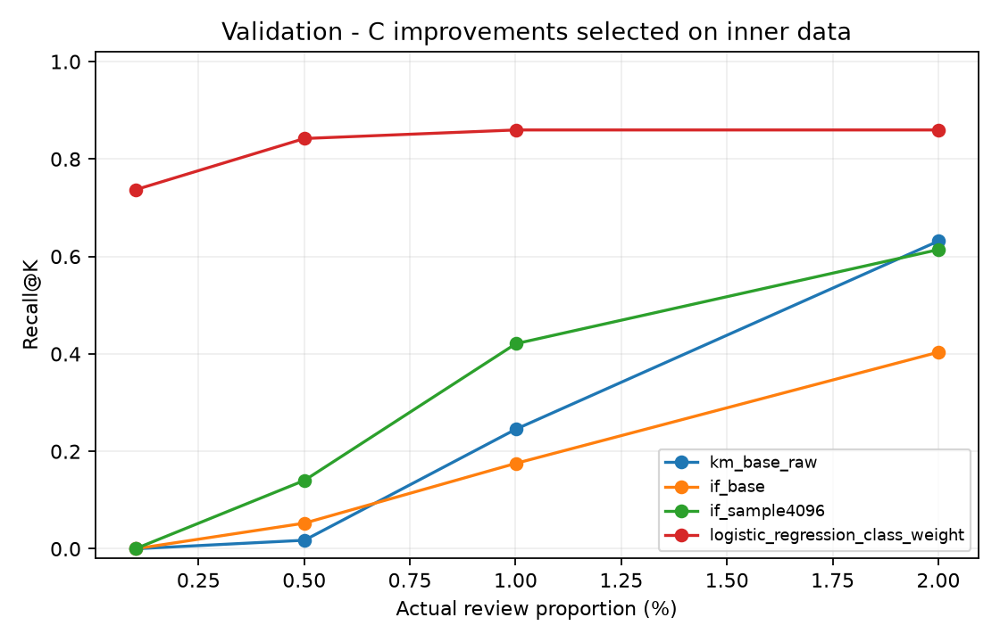

# C：方法、验证结果与运行说明

负责人 C。说明统一保存在本文件；代码在 `unsupervised.py` 和 `evaluation.py`，由 `main.py` 运行。

## 结果与当前配置

A 的原始数据校验、去重和正式时间划分保持不变：训练 170,235 笔/342 笔欺诈，验证 56,745 笔/57 笔欺诈。原始文件 SHA-256 与分段指纹见 `data/README.md` 和结果 JSON。

同样审核 K=568（1% 预算）：

| 方法 | 检出 TP | 误报 FP | Recall | Precision | AP |
|---|---:|---:|---:|---:|---:|
| 原簇中心距离 | 14 | 554 | 24.56% | 2.46% | 0.022831 |
| 原 IF：100 棵、抽样 256 | 10 | 558 | 17.54% | 1.76% | 0.016546 |
| 改进 IF：100 棵、抽样 4096 | 24 | 544 | 42.11% | 4.23% | 0.030021 |

当前交给 A 的候选是改进 IF：原始 30 个输入、训练段 StandardScaler、100 棵树、max_samples=4096、contamination=auto、seed=42、n_jobs=1。其余候选和失败结果保留，不再追加调参。

| 审核预算 | K | 原距离 TP | 原 IF TP | 改进 IF TP |
|---|---:|---:|---:|---:|
| 0.1% | 57 | 0 | 0 | 0 |
| 0.5% | 284 | 1 | 3 | 8 |
| 1%（主预算） | 568 | 14 | 10 | 24 |
| 2% | 1,135 | 36 | 23 | 35 |

相对原先最好的距离，1% 下多找到 10 笔，但仍漏掉 33 笔、误报 544 笔。0.1% 未改善，2% 时原距离略好。以上均为验证结果，最终测试没有执行。



## 方法与选择规则

第一轮 K-means 在训练特征上比较 k=3/5/8、种子 42/43，固定同一 1,000 笔子样本计算 silhouette/ARI。k=3 的平均 silhouette=0.1537、ARI=0.5558，因此选 k=3、n_init=10；稳定性仍有局限，群体不能等同于欺诈类别。

第二轮协议在运行前提交（Git `199ad5e`）。正式验证此前已被查看过，本轮不能称作全新的独立验证。为减少围绕 57 笔验证欺诈选参，在 A 的训练段内按时间再做一次 80/20 开发划分，同时间进入后段：

| 用途 | 笔数 | 欺诈 | Time 范围 |
|---|---:|---:|---|
| 内层拟合 | 136,186 | 258 | 0–81,825 |
| 内层选择 | 34,049 | 84 | 81,826–120,392 |

三种子 42/43/44 比较 20 个评分候选。按内层 1% 平均 TP 最大选择，并列比较平均 AP，再按预定候选顺序；距离家族保留原距离，IF 家族选择抽样 4096，整体选 IF。选择先落盘，再用完整 A 训练段、seed=42 重拟合并报告全部正式验证对照。模型拟合不读取标签，内层选择明确使用标签。

K-means 固定 k=3，六种配置各输出原始距离与簇内相对距离，共 12 个候选。相对距离为 `(d−所属簇训练距离中位数)/训练 IQR`，零 IQR 使用预定正下界；不在验证时重新标定。IF 八种配置见下表，无额外笛卡尔积搜索。共 42 次内层拟合、14 次全训练拟合，60 行内层评分。

| K-means 配置 | 原始距离 TP@1% | 相对距离 TP@1% |
|---|---:|---:|
| 原始标准化 | 14 | 11 |
| 去 Time | 19 | 26 |
| log1p 金额 | 18 | 17 |
| 去 Time + log 金额 | 17 | 14 |
| 原始 RobustScaler | 1 | 7 |
| 去 Time + log 金额 + RobustScaler | 1 | 7 |

| IF 配置 | TP@1% |
|---|---:|
| 原始 | 10 |
| 去 Time | 15 |
| log 金额 | 14 |
| 去 Time + log 金额 | 16 |
| 抽样 1024 | 19 |
| 抽样 4096 | 24 |
| 树数 300 | 13 |
| 去 Time + log 金额、300 棵、抽样 1024 | 17 |

验证 TP=26 的距离候选未被采用：其内层平均 TP 仅 24.33、范围 17–39，原距离则平均 63、三个种子均为 63。IF 抽样 4096 内层平均 64.67、范围 63–68；原 IF 平均 60.33。按预定规则保留选择，没有看到验证表格后换配置。更大的抽样在本次有效，不保证普遍有效；RobustScaler 和叠加改动也不保证改善。


## 组合、群体与时间

距离配额候选为 0/25/50/75/100%。按内层平均 TP 选，并列优先纯方法，再优先更大的距离配额；最终选 0% 距离、100% 改进 IF。验证 K=568 时，距离检出的 14 笔均被 IF 覆盖，IF 另有 10 笔独有欺诈；五种配额的验证 TP 为 24/24/24/22/14，混合没有额外收益。

群体统一由保留的 K-means 定义：验证簇 0 有 9,596 笔/14 欺诈，簇 1 有 47,149 笔/43 欺诈，簇 2 为空。空簇保留 N/A；组内预算与一个全局 top-K 的组间分配分别记录，不能混为同预算。匿名 V 特征不赋予未知业务含义，异常分也不是欺诈概率。

复用 A 的一小时窗口作验证诊断；首尾为不完整窗口，每窗正类仅 1–12 笔。短期波动、内层和验证结果落差不能直接证明长期漂移。最终窗口由 A 在 G2 冻结。

## 文件与运行

- `code/unsupervised.py`：C 的基线、改进模型及实验流程。
- `code/evaluation.py`：C 的共同评价、图、汇总导出和冻结评价；A/B/D 复用。
- `code/main.py`：保留 A 原入口，增加 `--run-c`、`--run-c-baseline`。
- `tests/test_c_modules.py`：合并 C 的全部检查。
- `results/tables/c_baseline.json`：基线指标、配置、训练结构与画像。
- `results/tables/c_improved.json`：改进指标、锁定选择、候选、分群、窗口及审计记录。
- `results/tables/c_ablation.csv`：便于报告/海报使用的 20 候选对照。
- `results/figures/c_*.png`：当前六张结果图及训练结构图。

激活环境、准备数据与检查：

```bash
source .venv/bin/activate
python code/download_data.py
python -m unittest discover -s tests -v
```

复现使用新的本地目录，防止覆盖仓库已有证据；新结果仍分为 figures/ 和 tables/：

```bash
python code/main.py --run-c --output data/c_reproduction/run --results data/c_reproduction/shared
```

`--run-c-baseline` 重现第一轮，`--demo` 只运行合成检查。B 的真实标准预测到位后追加 `--classification-predictions data/classifier_validation.csv`，列为 row_id/Class/Time/method/score。分类配额按预定规则在验证阶段选择，B5 来源与全组 G2 继续由相应成员确认。

模型、完整评分矩阵、错误样例和详细中间导出保留在私有运行目录。历史共享文件与旧结构快照保存在被 Git 忽略的 `data/_layout_archive/`，也可从 Git 历史恢复。汇总里的 source_commit/代码哈希继续指向真实拟合版本；本次整理不重训、不改变模型选择或验证数值。

全组 G2 后，A 从自己复现的模型调用冻结评价：

```python
import sys
sys.path.insert(0, "code")
import joblib
from evaluation import evaluate_improved_frozen
bundle = joblib.load("data/c_reproduction/run/improved_models.joblib")
# test 由 A 的唯一划分提供；冻结后才执行。
result = evaluate_improved_frozen(bundle, test, "data/c_final_test", phase="test")
```

它不重新拟合或选择配置，B 配额冻结后可传 classifier；未冻结时拒绝分类组合。第一轮 bundle 的对应接口为 `evaluation.evaluate_frozen_c`。恢复检查使用 phase="validation_replay"。旧自定义变换器已迁移到 unsupervised 模块路径，原模型备份保留，预测需保持一致。

整理核对：44 项 A/C 检查通过；临时接入 D 后 51 项检查通过且无合并冲突，D 未实际合入。原指标、选择和保留图片均已核对，两份旧模型在新模块路径下恢复后分数一致。

AIGC 记录：Codex 辅助协议、代码、训练验证、检查、结构整理与分析；组员须理解并审核，再据实际使用完善最终 Disclosures。当前没有 B5 真实分类结论或 A8 最终测试结果。
