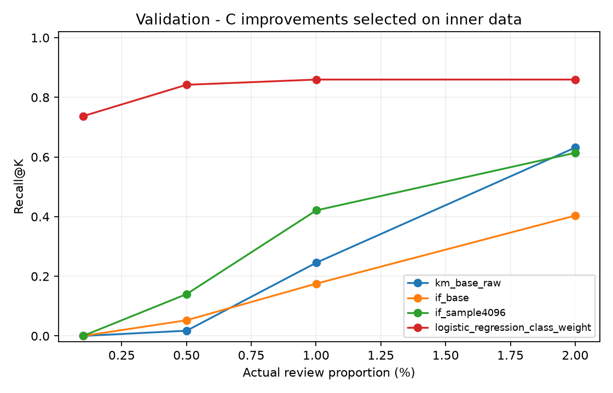
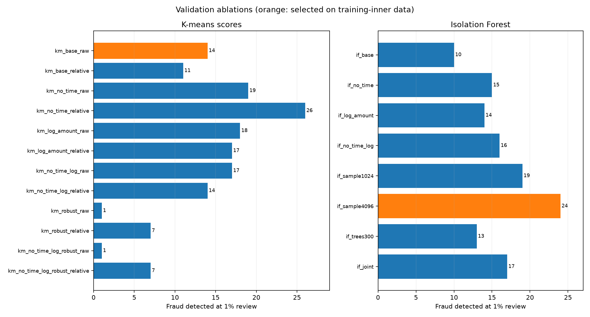
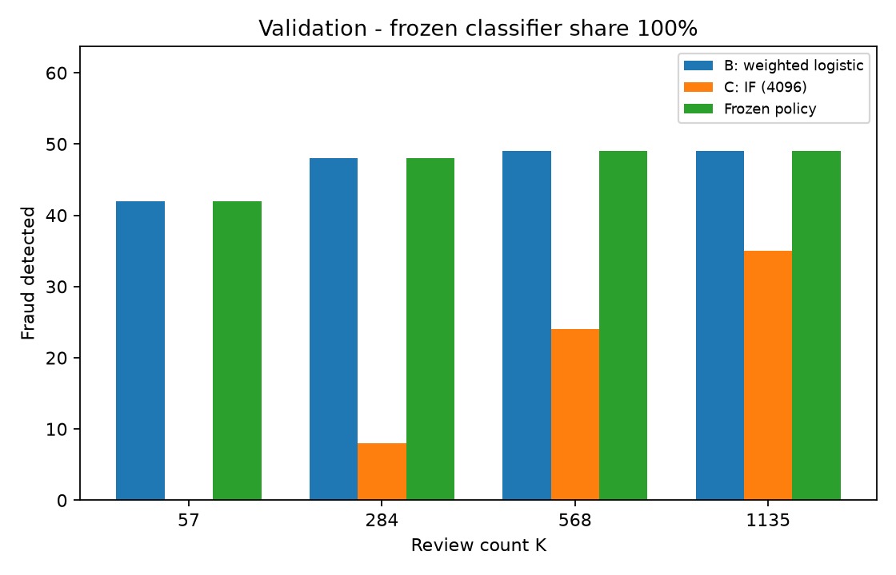
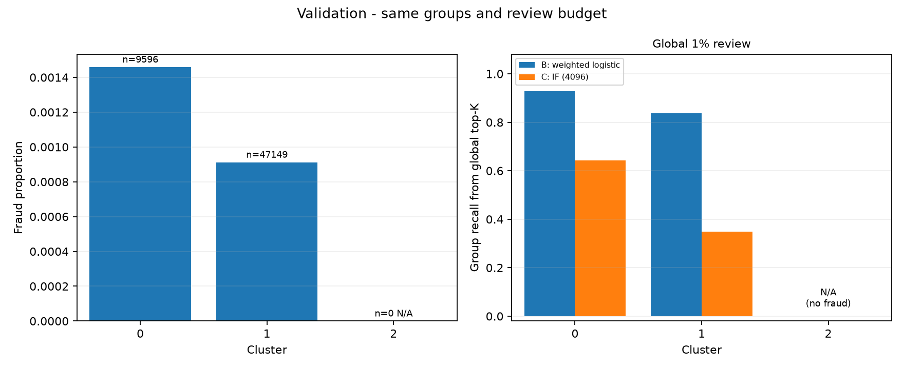
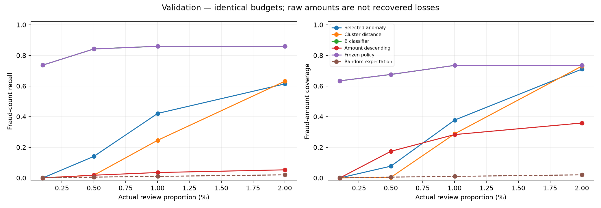
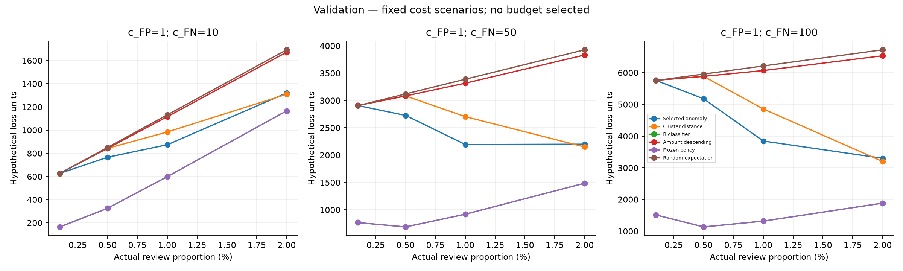
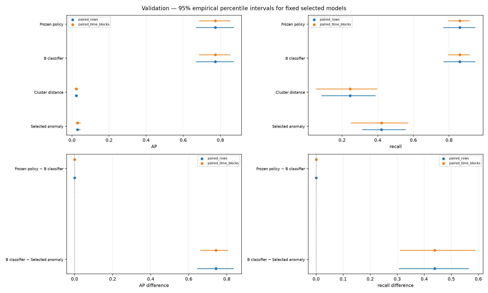
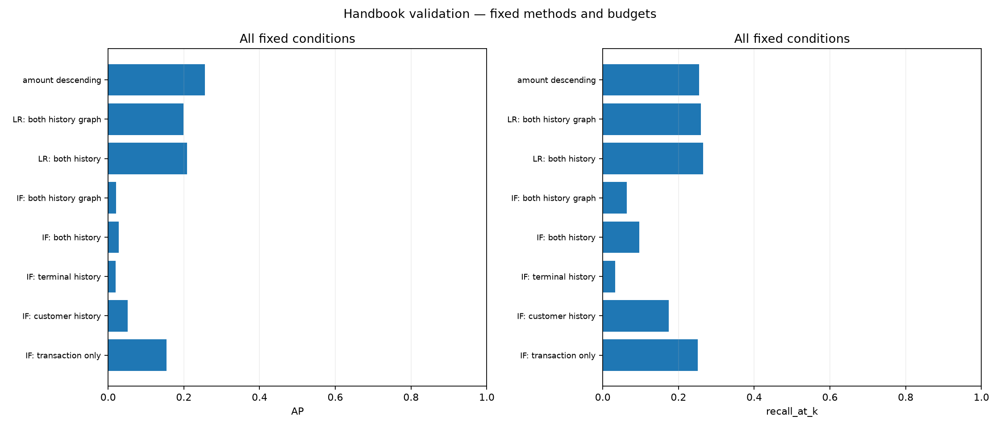
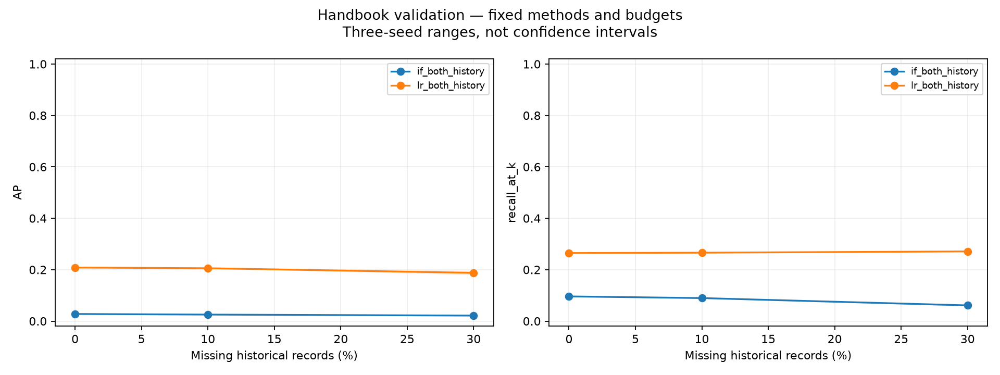

# 聚类、异常检测与公共评价说明

整理：2026-11-17。保留方法、选择依据、历史验证证据和指纹修复说明；删除逐次交接及旧任务状态。正式测试已完成，见 [测试总览](../results/tables/project_test.json)、[C 测试摘要](../results/tables/c_test.md)、[可靠性测试](../results/tables/c_extensions_test.json)和 [Handbook 测试](../results/tables/handbook_test.json)。以下标为验证的表格仍是 validation。运行命令统一见 README。

## 结果与当前配置

A 的原始数据校验、去重和正式时间划分保持不变：训练 170,235 笔/342 笔欺诈，验证 56,745 笔/57 笔欺诈。原始文件 SHA-256 与分段指纹见 `data/README.md` 和结果 JSON。

同样审核 K=568（1% 预算）：

| 方法 | 检出 TP | 误报 FP | Recall | Precision | AP |
|---|---:|---:|---:|---:|---:|
| 原簇中心距离 | 14 | 554 | 24.56% | 2.46% | 0.022831 |
| 原 IF：100 棵、抽样 256 | 10 | 558 | 17.54% | 1.76% | 0.016546 |
| 改进 IF：100 棵、抽样 4096 | 24 | 544 | 42.11% | 4.23% | 0.030021 |

冻结的无监督对照是改进 IF：原始 30 个输入、训练段 StandardScaler、100 棵树、max_samples=4096、contamination=auto、seed=42、n_jobs=1。其余候选和失败结果保留，不再追加调参。

| 审核预算 | K | 原距离 TP | 原 IF TP | 改进 IF TP |
|---|---:|---:|---:|---:|
| 0.1% | 57 | 0 | 0 | 0 |
| 0.5% | 284 | 1 | 3 | 8 |
| 1%（主预算） | 568 | 14 | 10 | 24 |
| 2% | 1,135 | 36 | 23 | 35 |

相对原先最好的距离，1% 下多找到 10 笔，但仍漏掉 33 笔、误报 544 笔。0.1% 未改善，2% 时原距离略好。以上均为原验证结果；正式测试另见顶部链接。

## 方法与选择规则

第一轮 K-means 在训练特征上比较 k=3/5/8、种子 42/43，固定同一 1,000 笔子样本计算 silhouette/ARI。k=3 的平均 silhouette=0.1537、ARI=0.5558，因此选 k=3、n_init=10；稳定性仍有局限，群体不能等同于欺诈类别。

第二轮协议在运行前提交（Git `199ad5e`）。正式验证此前已被查看过，本轮不能称作全新的独立验证。为减少围绕 57 笔验证欺诈选参，在 A 的训练段内按时间再做一次 80/20 开发划分，同时间进入后段：

| 用途 | 笔数 | 欺诈 | Time 范围 |
|---|---:|---:|---|
| 内层拟合 | 136,186 | 258 | 0–81,825 |
| 内层选择 | 34,049 | 84 | 81,826–120,392 |

三种子 42/43/44 比较 20 个评分候选。按内层 1% 平均 TP 最大选择，并列比较平均 AP，再按预定候选顺序；距离家族保留原距离，IF 家族选择抽样 4096，整体选 IF。选择先落盘，再用完整 A 训练段、seed=42 重拟合并报告全部正式验证对照。模型拟合不读取标签，内层选择明确使用标签。

K-means 固定 k=3，六种配置各输出原始距离与簇内相对距离，共 12 个候选。相对距离为 `(d−所属簇训练距离中位数)/训练 IQR`，零 IQR 使用预定正下界；不在验证时重新标定。IF 八种配置见下表，无额外笛卡尔积搜索。共 42 次内层拟合、14 次全训练拟合，60 行内层评分。

| K-means 配置 | 原始距离 TP@1% | 相对距离 TP@1% |
|---|---:|---:|
| 原始标准化 | 14 | 11 |
| 去 Time | 19 | 26 |
| log1p 金额 | 18 | 17 |
| 去 Time + log 金额 | 17 | 14 |
| 原始 RobustScaler | 1 | 7 |
| 去 Time + log 金额 + RobustScaler | 1 | 7 |

| IF 配置 | TP@1% |
|---|---:|
| 原始 | 10 |
| 去 Time | 15 |
| log 金额 | 14 |
| 去 Time + log 金额 | 16 |
| 抽样 1024 | 19 |
| 抽样 4096 | 24 |
| 树数 300 | 13 |
| 去 Time + log 金额、300 棵、抽样 1024 | 17 |

验证 TP=26 的距离候选未被采用：其内层平均 TP 仅 24.33、范围 17–39，原距离则平均 63、三个种子均为 63。IF 抽样 4096 内层平均 64.67、范围 63–68；原 IF 平均 60.33。按预定规则保留选择，没有看到验证表格后换配置。更大的抽样在本次有效，不保证普遍有效；RobustScaler 和叠加改动也不保证改善。

## 组合、群体与时间

距离配额候选为 0/25/50/75/100%。按内层平均 TP 选，并列优先纯方法，再优先更大的距离配额；最终选 0% 距离、100% 改进 IF。验证 K=568 时，距离检出的 14 笔均被 IF 覆盖，IF 另有 10 笔独有欺诈；五种配额的验证 TP 为 24/24/24/22/14，混合没有额外收益。

群体统一由保留的 K-means 定义：验证簇 0 有 9,596 笔/14 欺诈，簇 1 有 47,149 笔/43 欺诈，簇 2 为空。空簇保留 N/A；组内预算与一个全局 top-K 的组间分配分别记录，不能混为同预算。匿名 V 特征不赋予未知业务含义，异常分也不是欺诈概率。

复用 A 的一小时窗口作验证诊断；首尾为不完整窗口，每窗正类仅 1–12 笔。短期波动、内层和验证结果落差不能直接证明长期漂移。最终窗口由 A 在 G2 冻结。

## B 接入后的真实互补与冻结结果

B 分支 55ee151 已包含 A/C，因此直接接入无冲突。其原实验使用 sklearn 1.8.0 等版本，与共同依赖不同。本次在 Python 3.12.14、NumPy 2.5.4、pandas 3.1.1、sklearn 1.9.1、SciPy 1.18.1 下，按 B 原协议复核全部六个候选。未修改 B 的代码或已发布结果。

全部候选在主预算的 TP 与 B 原记录一致，选择仍为 `logistic_regression_class_weight`。该模型 AP=0.772681；随机森林 AP 从原记录 0.757048 变为 0.755615，版本差异已保留，不宣称所有数字逐位一致。重新保存/加载后，本地分数与完整排名一致。数据 SHA-256、正式划分指纹、所选参数均匹配 B 声明，真实 G1 原始逻辑回归的 AP/预算与独立复核一致。

| 预算 | K | B 分类 TP | IF TP | 冻结策略 TP |
|---|---:|---:|---:|---:|
| 0.1% | 57 | 42 | 0 | 42 |
| 0.5% | 284 | 48 | 8 | 48 |
| 1% | 568 | 49 | 24 | 49 |
| 2% | 1,135 | 49 | 35 | 49 |

主预算下，B 的 Recall=85.96%、Precision=8.63%，仍有 8 笔漏检。IF 的 24 笔欺诈全部被 B 的名单覆盖；B 独有 25 笔、IF 独有 0 笔。分类配额 0/25/50/75/100% 的 TP 分别为 24/45/48/49/49，按“TP 并列保留更多分类容量”的原规则选择 **100% 分类、0% IF**。这是合法的纯方法端点，不把它包装成混合策略改善。

2% 时 IF 有 1 笔独有欺诈，但 25% 分类配额的示例同时损失 1 笔 B 独有欺诈，检出仍是 49。其他已试配额也没有净收益。这只说明当前数据、容量和有限策略中没有组合提升，不能据此认定异常方法在所有场景都无用。

群体统一使用同一 K-means，主预算的一个全局名单中：

| 簇 | 笔数/欺诈数 | B 审核数/检出 | B Recall | IF 审核数/检出 | IF Recall |
|---|---|---|---:|---|---:|
| 0 | 9,596 / 14 | 62 / 13 | 92.86% | 258 / 9 | 64.29% |
| 1 | 47,149 / 43 | 506 / 36 | 83.72% | 310 / 15 | 34.88% |
| 2 | 0 / 0 | 0 / 0 | N/A | 0 / 0 | N/A |

三个真实案例可帮助讲解，完整行身份只保存在本地 `private_cross_method_cases.csv`：

| 案例 | 标签 | B 排名 | IF 排名 | 可支持的说明 |
|---|---:|---:|---:|---|
| C1 | 欺诈 | 4 | 605 | 分类能抓住未进入 IF 主预算名单的欺诈 |
| C2 | 欺诈 | 11,505 | 867 | IF 在 2% 容量下有独有发现，但固定容量组合未增加总检出 |
| C3 | 正常 | 56,545 | 1 | 异常程度最高也可能是正常交易，不能把异常分当欺诈概率 |

排名从 1 开始。这些是事实性案例，不从匿名特征推断具体消费或犯罪行为。

冻结记录在 `results/tables/c_improved.json` 的 config/B_reproduction/completion_verification：C 模型与原 20 候选结果未变，分类配额=1.0，threshold=null，K 向上取整、score 降序/row_id 升序；保存训练段模型，不合并 train+validation 重训。本地完整模型包自动包含 B，验证重放会核对所有风险分数、指标和容量。B 的原预测字节哈希与重建文件可能不同，原值和新值分别保存，不以字节相同冒充跨版本分数一致。

C5、C6、C8 的方法/验证写作与问答已交付。C7 的最终测试图和报告最终测试数字仍需 A 汇总 G2 并执行 A8：当前 B/D 冻结文件与本地 C 包均未宣称全组 G2 完成，所以本次没有评分测试集。不能用验证图代替最终图。

供组员审核改写的英文素材：

Under the same 1% review budget, the reproduced class-weighted logistic regression detected 49 of 57 validation fraud cases, whereas the improved Isolation Forest detected 24. All 24 anomaly detections were covered by the classifier's top-K list. The predeclared quota search therefore selected the pure-classifier endpoint: a 75% classifier quota tied its detected-fraud count, and the tie rule preferred more classifier capacity. At 2%, one anomaly-exclusive fraud case existed, but a capacity-preserving policy traded away one classifier-exclusive fraud and produced no net gain. These findings support the value of evaluating complementarity under an identical capacity constraint, rather than using the larger union of two review lists.

答辩要点：异常更稀有不代表更像已知欺诈；有独有案例不等于净收益；相同 K、去重补齐和事先固定的并列规则是比较基础；选择纯分类不是失败，而是保留有证据支持的策略。当前结论为验证结论，最终泛化仍由 A8 检查。

最终核对：46 项 A/C 检查、8 项 B 检查通过；临时加入 D 的 7 项检查后共 61 项通过且无冲突，D 未实际合入。真实 G1、完整验证的冻结重放、行身份/容量/分群计数均已核对。B 的原算法、测试及发布结果文件未改动；测试集没有评分。

### E01/E06：数量与金额的差异

训练段的 Amount 分位边界为 21.94、200.0、1008.6402000000035；等于边界进入右组，外侧开放，未在验证段重新分箱。验证段欺诈交易金额总和为 12,231.09。

| 方法 | TP@1% | 笔数 Recall | 欺诈金额覆盖 | Precision 提升倍数 |
|---|---:|---:|---:|---:|
| 簇中心距离 | 14 | 24.56% | 28.80% | 24.54 |
| 改进 IF | 24 | 42.11% | 37.78% | 42.06 |
| 带权逻辑回归 | 49 | 85.96% | 73.48% | 85.88 |
| Amount 降序参考 | 2 | 3.51% | 28.30% | 3.51 |
| 已冻结 B/IF 政策 | 49 | 85.96% | 73.48% | 85.88 |
| 随机审核期望 | 0.5706（期望） | 1.001%（期望） | 1.001%（期望） | 1 |

所有方法 K=568。随机值为期望，不是一次实际抽样；K 向上取整使实际比例略高于 1%。金额参考的方向在协议中固定，不是根据结果选出的方向。

分类检出 49 笔，覆盖欺诈交易金额 8,987.38；IF 为 4,621.18。金额排序仅检出两笔却覆盖 3,460.87，说明数量和金额指标确实不同。金额覆盖不等于实际追回损失，也不能用它替换笔数评价。

全局分类名单在最高金额组审核 43 笔、检出该组两笔欺诈中的一笔；该组金额覆盖为 38.57%。这一组只有两笔欺诈，不能据此推断普遍群体差异。其余金额组及每种方法的全局名单分配在 JSON 中，组数、欺诈数、审核数、检出及金额均已加总核对。

### E07：成本假设影响预算解释

采用事前固定的 `L=FP+c_FN*FN`，c_FN=10/50/100，无真实货币单位、不要求 score 已校准。分类结果如下：

| 审核预算 | c_FN=10 | c_FN=50 | c_FN=100 |
|---|---:|---:|---:|
| 0.1% | 165 | 765 | 1515 |
| 0.5% | 326 | 686 | 1136 |
| 1% | 599 | 919 | 1319 |
| 2% | 1166 | 1486 | 1886 |

在这些验证数字和假设下，较高审核量并非总是更优，因为需要权衡新增检出与误报。这里只比较全部预定成本场景，没有选择新预算，主预算仍为 1%，没有根据表格替换原模型或配额。全部方法及随机期望的成本保留在 JSON。

### E02：配对区间与有限证据

seed=42，500 轮逐行配对、200 轮 1800 秒时间块配对，报告经验 2.5%/97.5% 分位。15 个块槽均有观测，首尾可能不完整；每轮按实际抽样 N 重新计算 K。逐行样本始终 N=56,745，正类数范围 37–79；块样本 N=44,888–63,330、正类数 29–83。本次所有轮次均有正类，其他数据出现空样本/无正类时接口会显式记录有效轮数和原因，不反复重抽掩盖问题。

| 量 | 点估计 | 逐行区间 | 时间块敏感性区间 |
|---|---:|---|---|
| 分类 AP | 0.7727 | [0.6690, 0.8712] | [0.6853, 0.8528] |
| IF AP | 0.0300 | [0.0213, 0.0449] | [0.0193, 0.0460] |
| 分类 Recall@1% | 0.8596 | [0.7692, 0.9465] | [0.7954, 0.9153] |
| IF Recall@1% | 0.4211 | [0.3129, 0.5569] | [0.2496, 0.5714] |
| 分类 − IF 的 AP | 0.7427 | [0.6441, 0.8357] | [0.6609, 0.8048] |
| 分类 − IF 的 Recall | 0.4386 | [0.3056, 0.5641] | [0.3098, 0.5882] |

在这两个重采样设定中，已选分类器保持较大优势。但这些区间条件于已选模型和当前验证样本，不包含全部训练/选参不确定性，不构成正式显著性检验，也不保证未来泛化。块区间不必比逐行区间更宽，少量时间块不足以证明长期漂移。

冻结配额是 100% 分类，政策与分类的 AP/Recall 差值在每轮均为零，因此区间为 [0,0]。这是同一排序的结构性一致，不是对所有可能组合策略的最优性证明。对将来可能出现的内部配额，接口只评价名单 Recall；没有统一连续风险分时 AP 为 N/A，不虚构一条组合 PR 曲线。

实现用每条原交易的抽样出现次数计算分组阈值 AP 和 top-K，避免每轮重复排序。小样例穷举重复抽样，与 sklearn 显式展开 AP 以及原 compare_review_lists 的展开组合结果对照；并列按 score、源 row_id、抽样实例顺序处理。所有方法共享相同抽样，未将重复源 ID 冒充唯一交易 ID 送入原接口。

## Handbook 历史与关系的验证发现

### E10/E12 实际结果

主预算 1%，每个排序均审核 1,454 笔。下表全部为 validation；金额覆盖指检出的欺诈金额占全部欺诈金额。

| 排序 | AP | TP@1% | Recall@1% | 金额覆盖@1% |
|---|---:|---:|---:|---:|
| 单笔 IF | 0.153913 | 324 | 25.10% | 65.12% |
| 客户历史 IF | 0.051731 | 225 | 17.43% | 50.06% |
| 终端历史 IF | 0.019456 | 42 | 3.25% | 7.79% |
| 两类历史 IF | 0.027708 | 124 | 9.60% | 30.73% |
| 两类历史＋关系 IF | 0.021323 | 82 | 6.35% | 18.41% |
| 两类历史 LR | 0.208312 | 342 | 26.49% | 66.08% |
| 两类历史＋关系 LR | 0.199072 | 334 | 25.87% | 65.44% |
| 原始金额降序 | 0.255694 | 329 | 25.48% | 65.82% |

本轮没有观察到“增加历史/图特征必然改善”的效果。IF 从单笔扩为两类历史后 AP 和固定预算检出均下降；加入关系量对 IF/LR 也都未改善。可能原因包括正常交易的上下文稀疏性也会形成异常、不同特征维度改变 IF 的切分分配、线性 LR 无法直接表达某些交互，但这些是解释假设，当前实验没有逐项证明。

原始金额排序 AP 最高，LR 两类历史则在 1% 下多检出 13 笔且金额覆盖稍高，说明全排序 AP、局部审核检出和金额收益需要同时报告。模拟器包含基于金额的人工机制，因此金额参考很强本身就是需要交代的限制，不能用模拟结果证明现实反欺诈泛化。保留全部预定视图和负结果，不按这些数值替换协议指定的两类历史参考。

### E14 实际结果

固定完整历史训练的两类历史模型，只重建评分历史；每种缺失率均保留三种子，当前交易、标签和 1,454 笔审核容量不变。

| 缺失历史 | IF AP 范围 | IF TP@1% 范围 | LR AP 范围 | LR TP@1% 范围 |
|---|---:|---:|---:|---:|
| 0% | 0.027708 | 124 | 0.208312 | 342 |
| 10% | 0.025057–0.025705 | 113–118 | 0.203870–0.206907 | 341–346 |
| 30% | 0.021305–0.021644 | 74–82 | 0.178961–0.195633 | 349–351 |

IF 的 AP、检出和金额覆盖随缺失而下降；30% 时金额覆盖为 17.97%–19.56%，低于完整历史的 30.73%。LR 的全排序 AP 下降，但同预算检出略升，30% 时金额覆盖为 66.45%–66.97%。不能把这一现象写成“数据丢失改善模型”：这里只证明排序不同部分对缺失的响应不同，尚未建立整体改善、统计显著性或现实因果。三种子范围只是固定随机条件的变化范围；掩码实际可用率及全部预算/金额/成本数字留在汇总，不以目标缺失率代替实际比例。

## 指纹差异排查与最小修复（2026-11-16）

本节保留已完成的根因与修复证据。修复只涉及计算指纹，不修改特征生成、模型输入、参数或评价，也不增加组员操作流程。

在 437,454 条开发记录、19 列特征上，使用相同原始文件和源码做了三组对照：

| 环境 | NumPy / pandas | 与 ARM 主环境比较 |
|---|---|---|
| ARM 主环境 | 2.5.4 / 3.1.1 | 基准 |
| ARM、B 原依赖版本 | 2.4.4 / 3.0.2 | 全部数值逐位一致 |
| x86、B 原依赖版本（Rosetta） | 2.4.4 / 3.0.2 | 只有 time_sin/time_cos 不同 |

x86 对照中，time_sin 有 71,665 行、time_cos 有 89,185 行相差最后 1 个浮点位，最大绝对差均为 1.1102230246251565e-16；其余 17 列，包括金额和全部历史统计，逐位一致。这复现了平台/数学实现的微小三角函数差异如何造成完全不同的精确哈希；单纯把依赖版本改成 B 的版本并不能消除它。此外，B 的六份源码哈希均能在原源码的 LF/CRLF 两种表示中找到精确匹配，源码换行不是逻辑不同。

共享 `_handbook_view_fingerprints` 现在采用 `handbook-view-v2-time12`：按 row_id 排序、固定数值编码，**仅计算哈希时**将两列时间编码统一到小数点后 12 位，金额和历史值不舍入。三个环境的训练/验证四视图共八个新指纹全部相同。测试同时确认金额或历史数值改变后指纹仍改变，函数不修改原特征表。

已用锁定环境重新运行 B 的四视图/冷启动和 C 的全部 Handbook 验证，B/C 八个 v2 指纹完全一致。B 的四组评价、金额和冷启动统计与旧发布结果完全一致；C 的指标、成本、九个压力条件以及八份逐行预测 CSV 哈希不变。88 项公共检查＋11 项分类检查通过。新结果已写回原 handbook_b.json、handbook_c.json；原结果保留在 Git 历史，检查细节集中于 handbook_c_readiness.json 的 fingerprint_resolution。

旧 Windows 原始特征表没有存入仓库，故无法逐列重建其旧指纹，不将历史摘要改写成“逐位完全相同”。旧摘要使用未标版本的精确哈希，新摘要明确记录 v2；二者不直接比较。当前数值指纹的跨平台问题已修复并验证，无需为它单独增加 A7 审批或新任务。A6 合入后组员拉取同一 main，沿用原运行命令即可；A7/A8 的常规模型冻结和正式测试安排不变。

## 来源与实际协助

完整候选、训练内部选择、验证和复核证据分别保存在 c_baseline.json、c_improved.json、c_ablation.csv、c_extensions.json、handbook_c.json 和 handbook_c_readiness.json。这些验证配置仍供统一重建读取，不因最终测试已完成而删除。

Codex 辅助协议、实现、检查、训练验证、冻结发布接口、指纹排查、正式测试与材料整理。成员需理解并核对后形成自己的最终报告，按实际使用披露协助。
