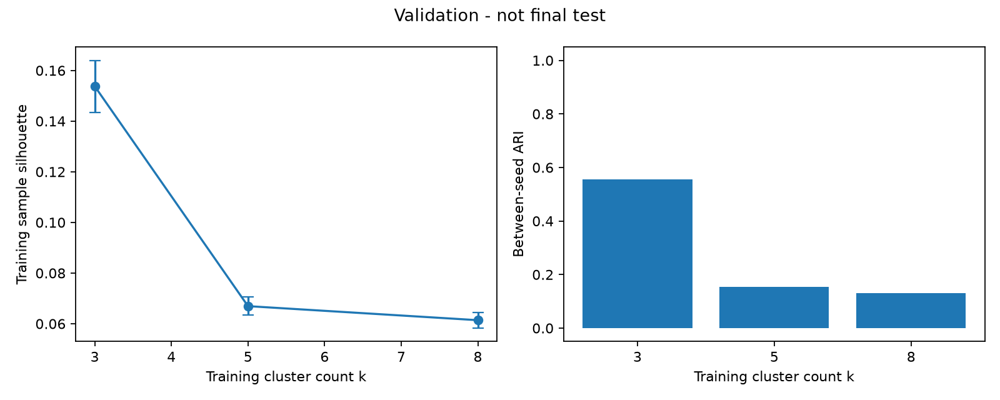
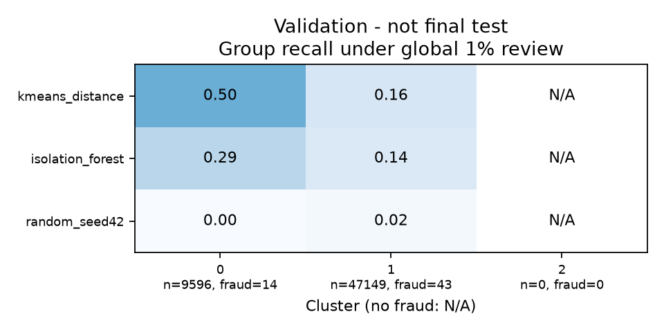
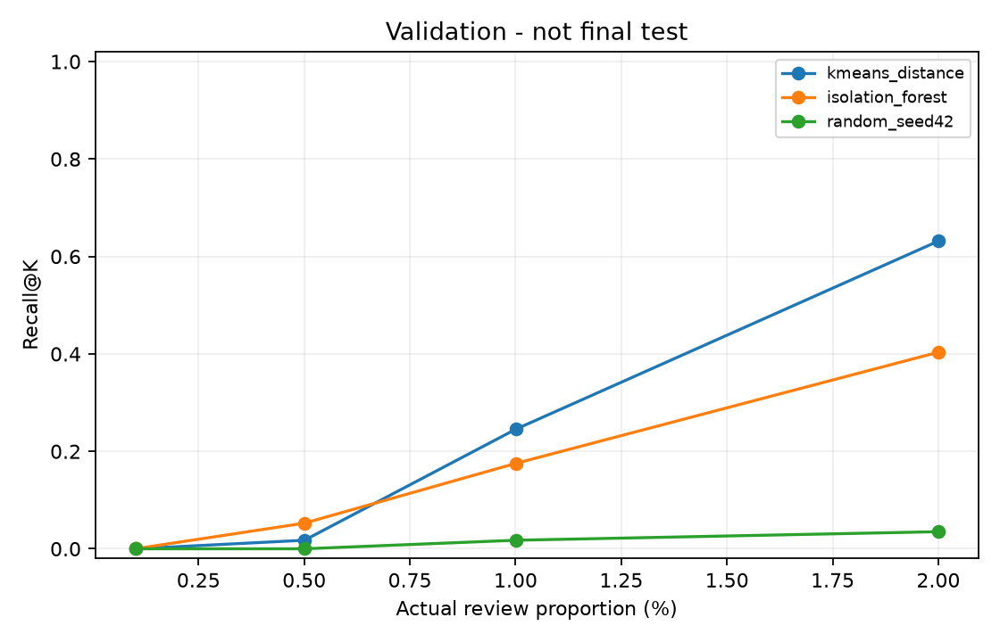
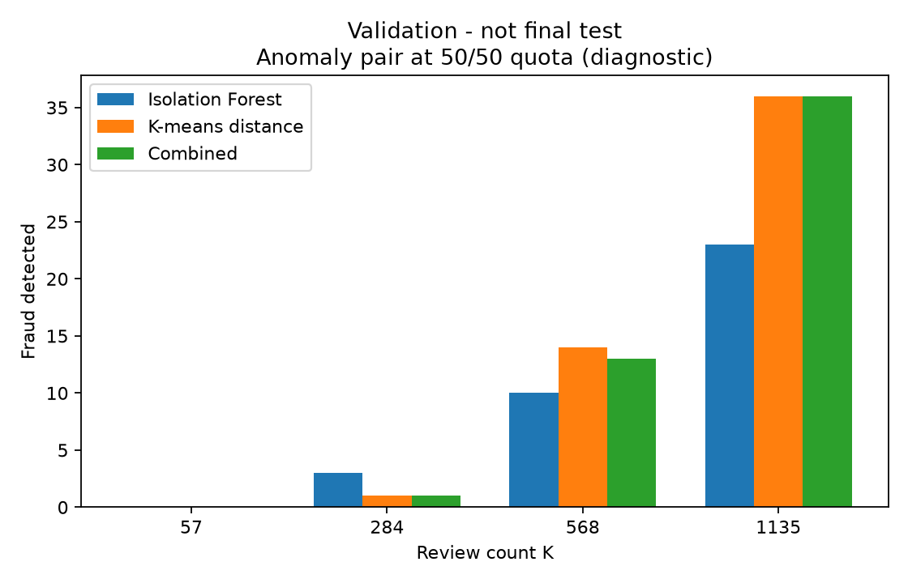

# C：真实训练/验证分析

负责人 C，2026-11-11。此处是经程序核对的验证分析素材，需要组员审核并与 B/A 的后续结果整合；不是最终测试报告。预定口径见 [C_PROTOCOL.md](C_PROTOCOL.md)，复现命令与接口见 [C_HANDOFF.md](C_HANDOFF.md)。

## 数据与运行范围

A 分支 `Task_A` 的 `26c1c32` 已合入 C 分支，去重、稳定 row_id、时间切分均直接复用 A，未另造划分。原始 SHA-256 为 `76274b691b16a6c49d3f159c883398e03ccd6d1ee12d9d8ee38f4b4b98551a89`。去掉 1,081 条额外完全重复记录后：

| 用途 | 笔数 | 欺诈数 | Time 范围 |
|---|---:|---:|---|
| 训练 | 170,235 | 342 | 0–120,392 |
| 验证 | 56,745 | 57 | 120,393–145,233 |

训练/验证有序 row_id 指纹与 A 的公布值一致。测试段仅做 A 的身份/计数复现，没有模型打分或方法比较。本次使用与 A 一致的固定依赖，35 项 A/C 检查通过，`pip check` 无依赖冲突；它不是 B2 真实 G1 或完整 G3 的完成证明。

原始字节、模型拟合与指标来源保存在 `results/c_validation/summary.json`、`c_freeze.json`，其中记录干净工作区源 commit、六个相关代码文件 SHA-256、版本、参数和行号指纹。正式复现命令：

```bash
python code/run_c_validation.py --data data/creditcard.csv \
  --output data/c_validation_reproduction \
  --publish results/c_validation_reproduction
```

## 训练结构：为什么选 k=3

全部 30 个既定特征经训练段 StandardScaler 后拟合；候选 k=3/5/8、种子 42/43、每次 n_init=10。所有候选用同一 1,000 笔训练子样本评估 silhouette 和两种种子分配的 ARI。选择规则只看训练特征。

| k | 平均 silhouette（两种子） | 子样本种子稳定性 ARI |
|---|---:|---:|
| 3 | 0.1537 | 0.5558 |
| 5 | 0.0669 | 0.1530 |
| 8 | 0.0614 | 0.1317 |

因此沿预定规则选 k=3，最终种子固定为 42。k=3 的结构质量和稳定性相对更好，但这些数值不表明群体具有已知业务意义，也不证明欺诈分类准确。ARI 约 0.56 说明种子间仍有差异，不能称为高度稳定。训练惯性随 k 增加而下降，不能只凭这一点选择更多簇。



## 群体画像与空簇

标签只在模型拟合后用于描述：

| 簇 | 训练笔数 | 训练欺诈 | 验证笔数 | 验证欺诈 | 验证欺诈比例 |
|---|---:|---:|---:|---:|---:|
| 0 | 23,559 | 182 | 9,596 | 14 | 0.1459% |
| 1 | 126,540 | 109 | 47,149 | 43 | 0.0912% |
| 2 | 20,136 | 51 | 0 | 0 | N/A |

簇 0 在训练段约包含 53.2% 欺诈，但验证段只有 24.6% 欺诈属于它；验证欺诈主要在簇 1。训练簇 2 在验证段没有分配样本，图表显式保留 n=0 和 N/A。这说明训练画像不能直接当作验证段的标签构成；原因可能涉及不同时间段的特征构成和训练结构，仅凭这些数据不能认定概念漂移。

1% 的一个全局审核名单中，距离方法在簇 0/1 分别审核 248/320 笔，检出 7/7 笔，对应组内 Recall 为 50.0%/16.3%；IF 分别审核 270/298 笔，检出 4/6 笔，Recall 为 28.6%/14.0%。样本较多的簇 1 包含 43 笔验证欺诈，两个方法在这一群体都漏掉较多。不能把这些结果理解为对客户群体的公平性判断：数据没有已知客户身份或敏感属性。



## 异常排序与审核预算

IF 固定 100 棵树、max_samples=256、contamination=auto、seed=42。分数为负 score_samples，越大越可疑；距离使用标准化空间中到最近训练中心的欧氏距离。训练不按标签筛正常样本。每种方法与同一验证段比较，K=ceil(Nq)。

| 预算 | K | 距离 TP | 距离 Recall | IF TP | IF Recall |
|---|---:|---:|---:|---:|---:|
| 0.1% | 57 | 0 | 0.00% | 0 | 0.00% |
| 0.5% | 284 | 1 | 1.75% | 3 | 5.26% |
| 1%（预定主预算） | 568 | 14 | 24.56% | 10 | 17.54% |
| 2% | 1,135 | 36 | 63.16% | 23 | 40.35% |

距离 AP=0.022831，IF AP=0.016546，验证欺诈比例约 0.001004。距离在预定 1% 主预算下检出更多，因此选择它作为后续分类组合的异常输入。这一步使用了验证标签，不能说整个方案从未使用标签。

但距离不是所有容量下都更好：0.5% 时 IF 检出 3 笔、距离只有 1 笔；两者在 0.1% 都为零。1% 时距离误报 554 笔，Precision 仅 2.46%；IF 误报 558 笔，Precision 1.76%。异常程度很高的正常交易占用不少审核资源，结果不支持把异常分等同于欺诈概率。

随机审核在 K=568 时理论 E[TP] 约 0.57；seed=42 的单次随机排序本次检出 1 笔。后者只是一次实现，不替代理论期望或统计显著性检验。



## 名单互补：有独有欺诈，不保证组合改善

此处仅比较 IF 与簇距离，不涉及尚未完成的 B 分类器。K=568 时，两张纯 top-K 名单共同检出 9 笔欺诈，IF 独有 1 笔，距离独有 5 笔。两张名单的欺诈并集是 15 笔，但名单并集的审核容量也增加，不能把 15 笔当成 K=568 的组合效果。

保持总数仍为 K=568，先取 IF 配额，再从距离排序去重补齐：

| IF 配额 | 距离配额 | 组合 TP |
|---|---|---:|
| 0% | 100% | 14 |
| 25% | 75% | 14 |
| 50% | 50% | 13 |
| 75% | 25% | 7 |
| 100% | 0% | 10 |

这一组预定候选中没有组合优于纯距离。50/50 的图仅作诊断，不能因为存在 IF 独有欺诈就声称组合有收益。未来分类组合将按相同预算/去重补齐规则，在 B5 的实际分类预测到位后评价。



## 时间诊断与错误样例

复用 A 的 origin=0、window_seconds=3600 接口，验证数据覆盖 window_id 33–40，首尾为不完整窗口。每个窗口重新分配本窗口的 1% 容量，和一个全局 top-K 不同；各窗取整后 K 的总和也可能不同。

窗口只含 1–12 笔欺诈，例如末窗只有 2 笔，距离检出 2 笔就会呈现 100% Recall，而这不意味着稳定可靠。当前窗口差异不能推出长期漂移、工作日规律或个人交易行为。最终窗口设定与测试分析由 A 在 G2/G3 推进。

本机 `private_error_examples.csv` 为每种排序保存至多五个高分误报及漏报的 row_id/Time/score。可用于核对选入与未选入名单；匿名特征和短期样本不足以推断具体欺诈机制，案例未公开为完整交易列表。

## 冻结与尚待完成的结论

无监督部分已按预定规则冻结：k=3、训练段缩放/拟合、IF 固定参数、距离为后续异常输入、共同预算与排名规则。保存训练管线，不在 train+validation 上重拟合。

B 的分类文件仍为 NotImplementedError 占位，远端没有 B 结果分支。因此当前不能填写“分类是否优于异常”“分类与异常组合提高多少”或最终分类配额。`c_freeze.json` 明确保留 waiting_for_B5，group_G2_complete=false。C 的所有接入/配额选择和冻结后评价代码已实现；最终测试和正式报告结论依赖全组阶段完成。

## 供审核改写的英文分析素材

The fixed training-structure comparison selected three clusters. The mean sampled silhouette score was 0.1537, with an adjusted Rand index of 0.5558 between the two seeds on the same training subsample. These measures describe feature-space structure rather than fraud classification quality. One trained cluster received no validation transactions and is explicitly reported as empty.

At the predeclared 1% review budget, both anomaly methods reviewed 568 validation transactions. Cluster-centre distance detected 14 of 57 fraud cases, compared with 10 for Isolation Forest, giving recalls of 24.56% and 17.54%. Their precisions remained low at 2.46% and 1.76%. The ordering depended on the budget: Isolation Forest detected more cases at 0.5%, whereas neither method detected fraud at 0.1%.

At K=568, the pure anomaly lists shared nine detected fraud cases; Isolation Forest had one unique case and distance had five. Nevertheless, a capacity-preserving 50/50 combination detected only 13 cases, below the 14 detected by distance alone. Unique coverage therefore did not automatically translate into a useful combined review policy. These are validation findings; classifier complementarity and final held-out performance remain to be evaluated after the corresponding group milestones.

## 检查与修订记录

- 首轮真实运行前已提交 C_PROTOCOL 与运行代码，未根据结果扩大候选或改主预算。
- 首轮汇总只包含验证实际出现的簇；修订为保留训练声明的全部簇，并修正空簇图的刻度/标记。此后重跑用于核对公开材料，原始运行与其聚合结果保留在本地，模型候选、参数、划分和评价选择规则未改变。
- 35 项 A/C 检查、完整固定依赖、原始 SHA-256 和三段行号指纹均通过；还检查本地保存模型恢复后的验证预测一致，以及公开汇总没有完整交易 ID/PR 数组/模型。
- 这不是第二台电脑的完整 G1/G3 复现，也不是最终测试成绩。AIGC 使用记录见 C_HANDOFF.md，组员须审核后纳入最终 Disclosures。
