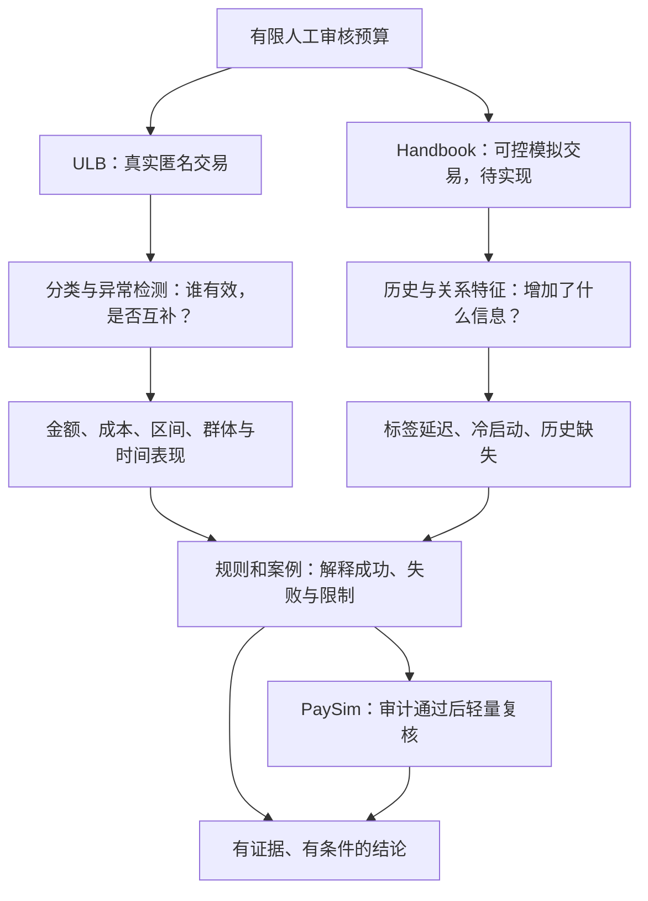

# Group 20：项目故事与研究逻辑

更新：2026-11-15。本文帮助组员理解整个项目为什么做、每项实验回答什么，以及怎样把结果串成报告和答辩。

**这是完整设计的说明，不表示所有功能已经完成。**截至本文日期，ULB 已有主要验证证据，C 扩展与统一验证入口已交付；B 的部分扩展、全组冻结和正式测试仍待完成。Handbook、PaySim 及新增上下文实验已列入任务，尚未运行。实际进度以 [TASKS.md](../TASKS.md) 和各分支交付记录为准。

阅读分工：本文讲“为什么和怎么串起来”；[README](../README.md) 讲范围、状态与入口；[扩展协议](EXTENSION_PROPOSALS.md) 讲实验参数和边界；TASKS 讲谁做、先做什么。

## 1. 一句话讲清项目

> 在有限的人工审核预算下，哪些方法、哪些信息能帮助我们更有效地发现欺诈？当标签不足、历史不完整或遇到新客户时，这些方法还可靠吗？

项目分为三个层次：先比较检测方法，再研究上下文信息的价值，最后检验收益的可靠性。规则、案例和外部复核帮助解释结果的适用边界。

核心逻辑：

**有限审核资源 → 方法比较 → 等预算互补 → 上下文增益 → 信息受限时的可靠性 → 解释与适用边界。**

PaySim 是条件式补充，不阻塞前两条数据线。图中的新增模块表示设计关系，不是已实现状态。

## 2. 四个研究问题

| 问题 | 需要回答什么 | 对应内容 |
|---|---|---|
| RQ1 检测有效性 | 相同审核预算下，分类与异常检测分别能发现多少欺诈，是否互补？ | ULB 主对照、E01/E06/E07 |
| RQ2 上下文价值 | 客户历史、终端历史和关系信息分别贡献多少？ | Handbook、E09/E10/E12 |
| RQ3 可靠性 | 少样本不确定性、标签不足/延迟、新实体和不完整历史会怎样影响表现？ | E02/E03/E08/E11/E13/E14 |
| RQ4 解释与边界 | 哪些模式帮助解释成败，换数据来源后相对表现是否一致？ | E04/E05/E15/E16 |

每项实验至少对应一个问题。报告不按 A/B/C/D 分成四个互不相关的项目，也不要求每个算法各占一章。

## 3. 为什么需要这三套数据

| 数据 | 在故事中的作用 | 能回答的主要问题 | 解释边界 |
|---|---|---|---|
| ULB | 真实匿名交易上的主实验 | 方法比较、同预算互补、金额与可靠性 | 时间仅两天；匿名特征不能虚构业务含义，也没有客户历史标识 |
| Handbook | 有客户、终端和较长时间记录的受控实验 | 历史/关系增益、延迟、冷启动、历史缺失 | 欺诈由人工机制生成，不代表真实业务普遍效果 |
| PaySim | 另一支付模拟来源上的轻量复核 | 少量固定方法的相对表现是否保持 | 先审计；不复制整套主实验，也不能证明现实泛化 |

各数据集分别训练、分别留出测试。新数据不能直接套用 ULB 的已训练模型；AP 也受类别比例影响，不把不同数据集的 AP 平均成一个总成绩。

## 4. 第一幕：定义“有效”，建立可信比较

人工只能审核有限交易，因此检测是一个排序与名单选择问题。

- 输入：评分时可获得的交易特征。
- 输出：风险分数，以及预算 q 下的审核名单。
- 容量：K = ceil(N × q)，主预算为 1%，补充为 0.1%、0.5%、2%。
- 目标：在同一 K 下比较检出、误报、金额覆盖和错误代价。

例如，一万笔交易最多审核一百笔，各方法就使用同样的一百个名额。数据版本、清洗、时间划分、训练期预处理和稳定行号，都是为了让这个比较可信。

AP 描述整体排序；Precision/Recall@K 描述具体容量；金额覆盖描述检出的交易金额；成本场景描述假设错误代价。它们各有作用，不能互相替代。融合若只定义审核名单、没有统一连续分数，就不强行构造 AP。

## 5. 第二幕：分类与异常检测是否互补

ULB 上先比较四种基础分类器及有限的不平衡处理；再比较 Isolation Forest 和簇中心距离。K-means 还定义交易群体，用来检查总体结果是否掩盖群体差异。

接着检查名单重合：异常方法是否找到了分类遗漏的欺诈？在去重补齐后，总审核数仍必须恰好 K。两张各审核一百笔的名单直接合成两百笔，不能据此宣称方法改善。

当前验证发现：K=568 时，带权逻辑回归检出 49/57，改进 IF 检出 24/57；IF 的 24 笔均在分类名单内，预定配额规则选中纯分类端点。已试组合没有增加净检出。

这个结果可以支持一个清楚的结论：在当前数据、容量和已试政策下，没有证据表明组合优于分类。不能将其推广为“异常检测没有价值”，也不应为了展示融合收益不断改策略。

异常模型拟合不读取标签，与整个实验完全不使用标签是两件事。模型/配额选择若使用开发标签，报告必须说明。

## 6. 第三幕：领先结论是否完整、可靠

这一步将单一分数扩展为多个可核查的视角：

| 分析 | 为什么需要 |
|---|---|
| 金额覆盖 | 检出笔数相近时，覆盖的欺诈金额可能不同 |
| 假设成本 | 更多审核可能降低漏报，却增加误报代价 |
| 配对区间 | 少量欺诈样本下，方法差值存在不确定性 |
| 群体评价 | 总体领先不保证每个群体同样可靠 |
| 时间/阈值 | 固定阈值不保证每个窗口都审核相同比例 |

已有验证中，分类笔数召回约 85.96%，金额覆盖约 73.48%；Amount 降序参考只检出两笔，却覆盖约 28.30% 的金额。这说明两个评价目标确实不同，金额覆盖也不能称为实际追回损失。

区间条件于当前样本和已选模型，不覆盖全部训练/选择不确定性。成本比是假设，不能写成真实货币收益。无正类或零分母应记 N/A。

另一个已观察到的口径差异是：各小时窗口独立向上取整共审核 572 笔，全局名单审核 568 笔。IF 的窗口政策检出 28 笔、全局为 24 笔，容量和分配同时改变，不能直接称为同预算提升。

## 7. 第四幕：分类优势依赖多少标签

减少已标注训练交易，观察监督分类与无标签参考之间的差距如何变化。这承接前面的发现：完整标签条件下分类领先，那么标签不足时还能保持吗？

按协议使用 5/10/25/50/100% 标注比例和固定种子，隐藏标签不能改成正常；IF 参考不利用完整标签重新选参。需要说明两类方法可见的训练记录和信息不同。

学习曲线不要求出现交叉点。差距缩小、持续领先或结果波动，都是需要解释的结果。这部分尚待 B 完成，不能提前写结论。

## 8. 第五幕：上下文信息是否比单笔信息更有用

Handbook 让我们研究 ULB 无法回答的问题：某个客户最近交易是否变多、当前金额相对自身历史是否偏离、某个终端近期交易是否集中？

保持 LR/IF 的基本方法固定，依次比较：

1. 单笔交易。
2. 单笔＋客户历史。
3. 单笔＋终端历史。
4. 单笔＋两类历史。
5. 两类历史上再增加基础关系特征。

关系特征只包括过去连接过多少不同实体、当前客户–终端关系是否为新边。原始 ID 不作连续数值输入，不使用 GNN。

这组消融用来区分收益来自哪种信息，而不是同时更换模型、特征和预算。它尚未运行，不能预先断言历史或图特征一定有效。

历史只读取当前时间之前的交易，同时间批次先全部评分再更新。生成机制字段只能用于事后诊断，不能进入模型。

## 9. 第六幕：信息不理想时，上下文收益还在吗

| 条件 | 核心问题 | 控制方式 |
|---|---|---|
| 标签延迟 | 缺少近期已确认标签，会损失多少能力？ | 固定 0/1/7 天延迟、记录实际可用标签截止时间 |
| 开发期滚动 | 使用近期开发数据更新，与静态模型有何差异？ | 预定更新频率及窗口，不按最优 AP 挑快照 |
| 冷启动 | 对初始训练未见客户/终端是否可靠？ | 四个固定、互斥群体，报告样本量与全局名单分配 |
| 历史缺失 | 日志不完整时，模型依赖的上下文是否脆弱？ | 0/10/30% 历史缺失，当前交易与标签不删除 |

新数据的滚动发生在开发期。最终测试前，按事前时间规则保存每个情景的最后合法模型快照；测试期不训练、不用测试标签回填。原 ULB 政策保持不变。

稀有群体、少量欺诈和三种子波动都要如实标注，不能重生成直到得到漂亮的差异。这些研究讨论方法的适用条件，不把模拟设置冒充现实发生率。

## 10. 第七幕：解释成功、失败与结论边界

规则挖掘和错误案例贯穿前面的实验：

- ULB 检查匿名特征的短规则、留出覆盖、冗余及模型错误关联。
- Handbook 检查有语义的金额/历史规则，并按生成机制作事后分析。
- 特征重要性描述特定模型依赖什么；关联规则描述哪些现象共同出现。

它们不自动等于因果解释，也不保证高审核效率。例如，现有 ULB 规则并集覆盖约 98.78% 的验证交易、包含全部验证欺诈，这并不意味着规则优于只审核 1% 的模型。

最后，PaySim 在审计通过后重新训练少量固定方法，检查相对表现是否依赖单一来源。结果一致可提供补充支持；不一致同样有价值，应分析数据字段、类别比例及生成机制差异，不筛掉不利数据源。

## 11. 最终怎样组织报告和海报

报告仍按课程要求设置：Introduction、Problem Formulation、Methodology、Experiments、Conclusion and Limitations、Disclosures、References，必要时有 Appendix。

实验章节按研究问题组织：主比较与互补 → 数量/金额及可靠性 → 历史/关系消融 → 信息受限条件 → 规则解释和补充复核。不是把每种算法的原理依次写一遍。

正文保持 6–10 页。ULB 是真实匿名数据主线，Handbook 用 1–2 张组合图说明上下文及限制；完整种子、压力条件、规则与 PaySim 放补充材料。海报优先选择共同问题、两三项关键发现和局限，不展示所有实验表。

每项结论至少关联具体数据集、phase、方法、预算及图表来源。验证发现不能改名为正式测试结论，尚未完成的实验只能作为问题或计划。

## 12. 每个人在故事中的责任

| 成员 | 对主线的贡献 |
|---|---|
| A | 让数据、时间和信息可用范围可信，组织分数据集冻结与统一评价 |
| B | 回答有标签方法的能力、标签依赖、特征价值和冷启动表现 |
| C | 建立公平评价，研究异常/关系/压力条件，核对收益与不确定性 |
| D | 用规则与案例解释成败，将证据组织成报告和海报 |

所有成员都应能解释：为什么固定 K；如何避免未来泄漏；异常为什么不等于欺诈；规则覆盖为什么不等于审核收益；负结果意味着什么；模拟数据有什么限制；哪些是验证结果，哪些才是正式测试结果。

**我们希望证明的是：哪些方法与信息在什么条件下有用、证据有多充分，以及结论不能推广到哪里。**不预设某模型必须胜出，也不以新增数据量或模块数量代替研究质量。
