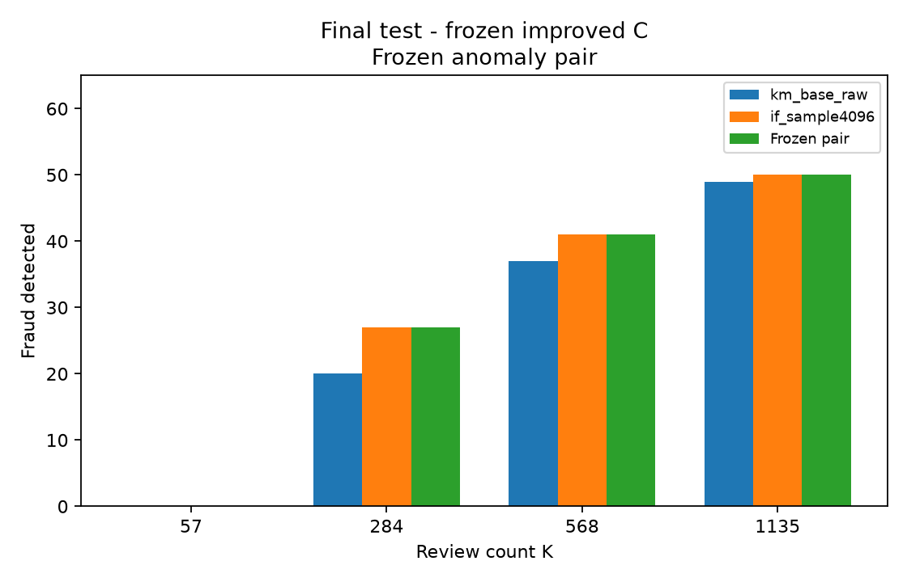
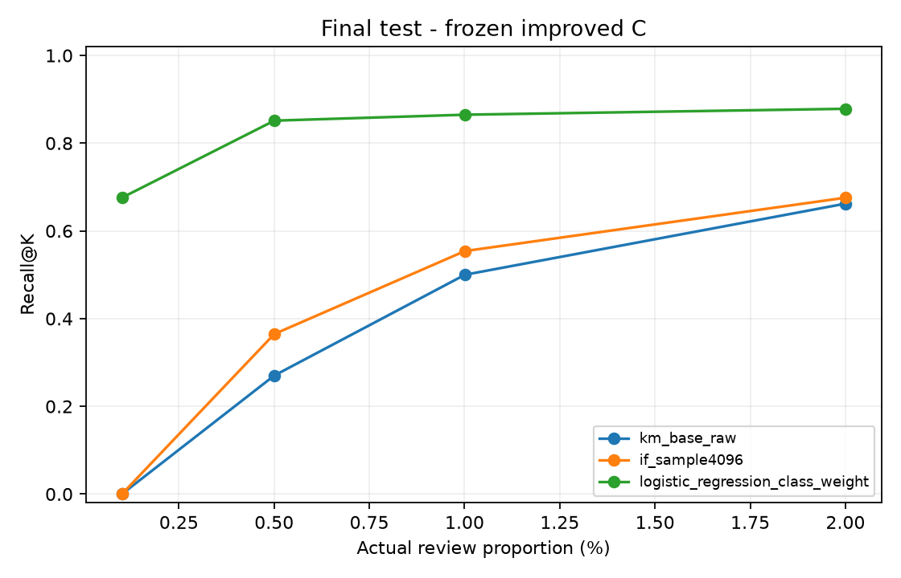
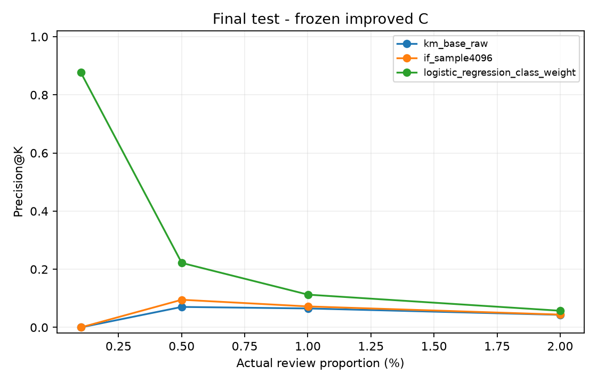
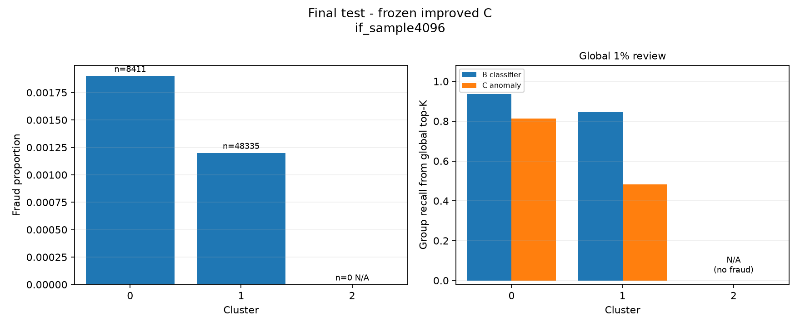
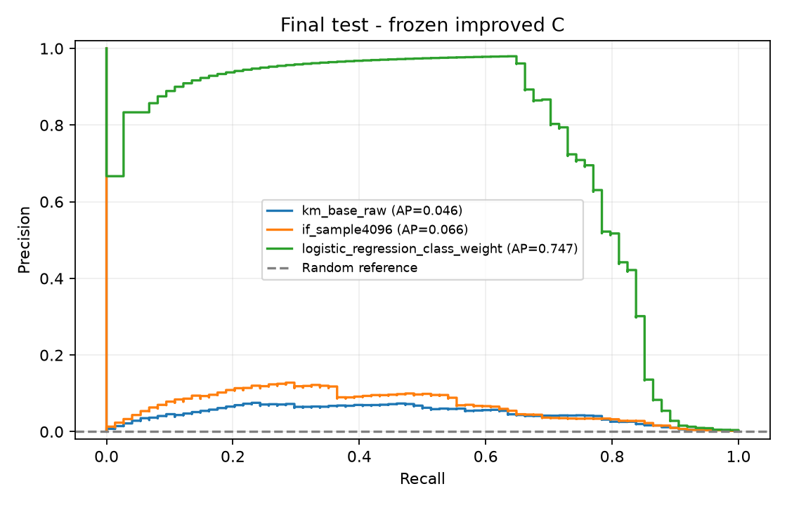
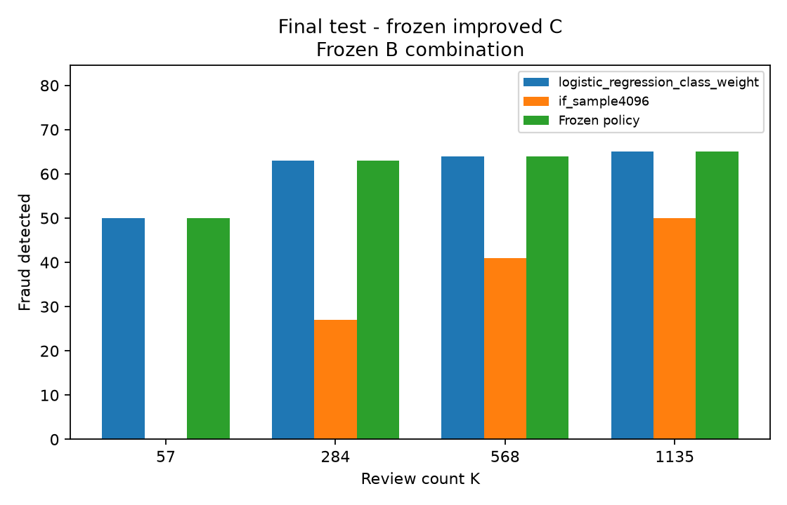

# C: Final test

Partition: 56,746 transactions, 74 frauds. All rankings use descending score, then ascending row_id; K = ceil(N × q).
Models, preprocessing and quotas were retained without refitting or reselection.

| Method | AP | Budget | K | TP | FP | Recall | Precision |
|---|---:|---:|---:|---:|---:|---:|---:|
| km_base_raw | 0.045960 | 0.1% | 57 | 0 | 57 | 0.000000 | 0.000000 |
| km_base_raw | 0.045960 | 0.5% | 284 | 20 | 264 | 0.270270 | 0.070423 |
| km_base_raw | 0.045960 | 1% | 568 | 37 | 531 | 0.500000 | 0.065141 |
| km_base_raw | 0.045960 | 2% | 1135 | 49 | 1086 | 0.662162 | 0.043172 |
| if_sample4096 | 0.065999 | 0.1% | 57 | 0 | 57 | 0.000000 | 0.000000 |
| if_sample4096 | 0.065999 | 0.5% | 284 | 27 | 257 | 0.364865 | 0.095070 |
| if_sample4096 | 0.065999 | 1% | 568 | 41 | 527 | 0.554054 | 0.072183 |
| if_sample4096 | 0.065999 | 2% | 1135 | 50 | 1085 | 0.675676 | 0.044053 |
| logistic_regression_class_weight | 0.747459 | 0.1% | 57 | 50 | 7 | 0.675676 | 0.877193 |
| logistic_regression_class_weight | 0.747459 | 0.5% | 284 | 63 | 221 | 0.851351 | 0.221831 |
| logistic_regression_class_weight | 0.747459 | 1% | 568 | 64 | 504 | 0.864865 | 0.112676 |
| logistic_regression_class_weight | 0.747459 | 2% | 1135 | 65 | 1070 | 0.878378 | 0.057269 |

## Equal-budget classifier / anomaly comparison

At 0.1% (K=57), classifier TP=50, anomaly TP=0, and frozen-policy TP=50. Shared frauds=0; classifier-only=50; anomaly-only=0. Net change from classifier=+0.
At 0.5% (K=284), classifier TP=63, anomaly TP=27, and frozen-policy TP=63. Shared frauds=27; classifier-only=36; anomaly-only=0. Net change from classifier=+0.
At 1% (K=568), classifier TP=64, anomaly TP=41, and frozen-policy TP=64. Shared frauds=40; classifier-only=24; anomaly-only=1. Net change from classifier=+0.
At 2% (K=1135), classifier TP=65, anomaly TP=50, and frozen-policy TP=65. Shared frauds=49; classifier-only=16; anomaly-only=1. Net change from classifier=+0.

## Groups under the global 1% review budget

| Method | Cluster | Transactions | Frauds | Reviews | TP | Group recall |
|---|---:|---:|---:|---:|---:|---:|
| km_base_raw | 0 | 8411 | 16 | 191 | 11 | 0.687500 |
| km_base_raw | 1 | 48335 | 58 | 377 | 26 | 0.448276 |
| km_base_raw | 2 | 0 | 0 | 0 | 0 | N/A |
| if_sample4096 | 0 | 8411 | 16 | 208 | 13 | 0.812500 |
| if_sample4096 | 1 | 48335 | 58 | 360 | 28 | 0.482759 |
| if_sample4096 | 2 | 0 | 0 | 0 | 0 | N/A |
| logistic_regression_class_weight | 0 | 8411 | 16 | 54 | 15 | 0.937500 |
| logistic_regression_class_weight | 1 | 48335 | 58 | 514 | 49 | 0.844828 |
| logistic_regression_class_weight | 2 | 0 | 0 | 0 | 0 | N/A |

## Interpretation and limits

Cluster IDs describe training-defined groups, not fraud predictions. Group recalls above use a single global top-K list, not separate group quotas.
Time windows use origin=0 seconds and width=3600 seconds, with independent top-K review within each window. Per-window review counts cannot be treated as the global review budget.
No-positive groups/windows have undefined AP and recall (N/A). A supplies the temporal interpretation; short-term differences do not establish drift.
Anomaly scores are not fraud probabilities. An exclusive fraud case alone does not establish a capacity-preserving gain; the net change above uses identical K.
Validation selection and final-test performance must be described separately. These descriptive results do not support causal or demographic claims.

## Figures

